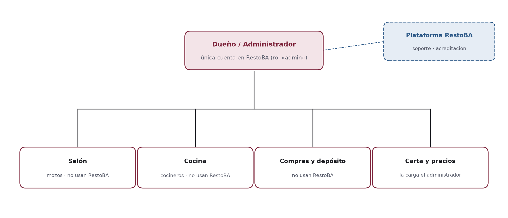
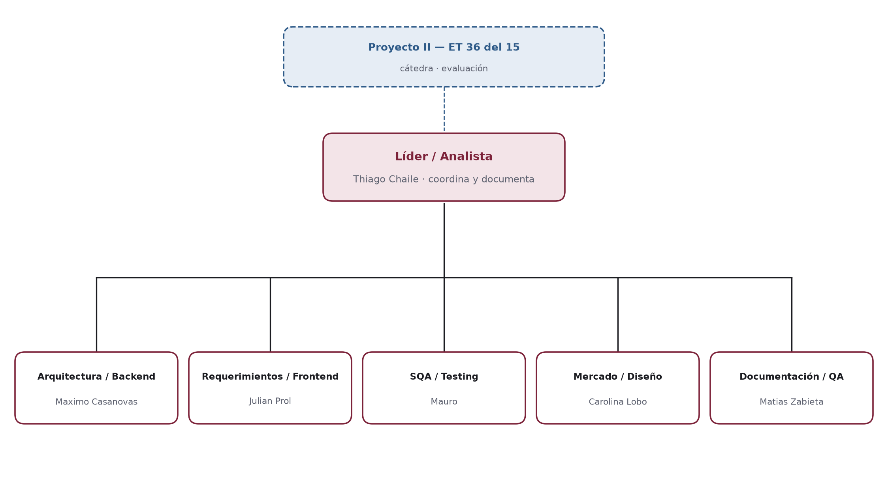
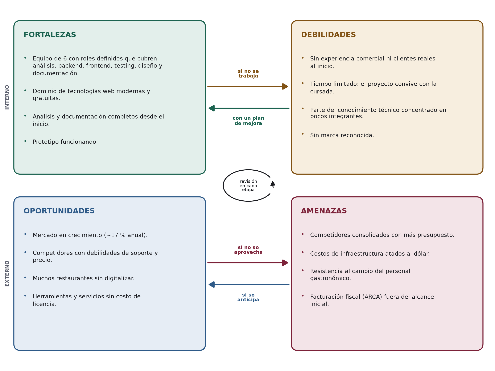

[← Introducción](01-introduccion.md) · [Índice](README.md) · [Etapa 2 — Diseño y arquitectura →](03-etapa-2-diseno.md)

---

# Etapa 1 — Análisis

**En esta página:** [Fase 1 — Reconocimiento](#fase-1--reconocimiento) · [Fase 2 — Relevamiento](#fase-2--relevamiento) · [Fase 3 — Estudio de mercado](#fase-3--estudio-de-mercado) · [Fase 4 — Factibilidades](#fase-4--factibilidades) · [O.L.A. — Objetivos, límites y alcances](#ola--objetivos-límites-y-alcances) · [Propuesta](#propuesta) · [Contrato](#contrato) · [Planificación](#planificación)

En esta etapa se reconoce el problema, se releva la información, se estudia el mercado y se comprueba que el proyecto es posible desde lo humano, lo técnico, lo económico y lo legal. Termina con la propuesta, el contrato y la planificación.

## Fase 1 — Reconocimiento

### Presentación del problema

Salir a comer tiene dos problemas que hoy no están bien resueltos.

**Del lado de las personas**, encontrar un buen lugar **cercano** y acorde a lo que se quiere comer (pastas, parrilla, pizza) sigue siendo difícil: la información está repartida entre Google Maps, Instagram y recomendaciones, sin la carta actualizada ni reseñas que se sepa que son de gente que fue.

**Del lado de los restaurantes** —sobre todo los pequeños y medianos— cuesta darse a conocer y llenar el salón: no tienen un lugar donde mostrar su carta actualizada a la gente que está cerca y busca exactamente lo que ellos ofrecen.

> [!IMPORTANT]
> **Solución propuesta:** una guía web donde el comensal descubre restaurantes cercanos, ve la carta y reserva, y donde el restaurante aparece a cambio de una suscripción mensual. El restaurante mantiene su carta desde un panel simple.

### Objetivos

**Objetivo general.** Desarrollar una página web responsiva que permita a los comensales descubrir restaurantes cercanos por tipo de comida, ordenados por cercanía y puntaje, en la que los restaurantes aparecen pagando una suscripción mensual.

**Objetivos específicos.**

- Registro e inicio de sesión del comensal con tres niveles (visitante, registrado y verificado) y acceso separado para el administrador del restaurante.
- Buscador por tipo de comida con resultados por cercanía (geolocalización) y por puntaje.
- Perfil del restaurante con carta, horarios, ubicación y enlace «Cómo llegar».
- Reservas con disponibilidad real según horario y mesas.
- Reseñas ligadas a una visita real, favoritos y programa de puntos y cupones.
- Suscripción del restaurante: solo los locales con la suscripción al día aparecen en el buscador.
- Panel del restaurante para mantener su carta, con aislamiento total de datos entre locales (multiempresa).

### Diagrama ambiental o de contexto

El diagrama de contexto muestra al **sistema como una sola caja** y, alrededor, a todos los **agentes exógenos**: las personas y los sistemas externos con los que intercambia información. Sirve para analizar quiénes son los usuarios, en qué medio interactúan y si hay una base de datos de por medio. Se hace en esta fase porque define el límite del sistema antes de diseñar nada.

Cada flecha es un intercambio en los dos sentidos: lo que el agente entrega al sistema (→) y lo que recibe (←). El diagrama está en la página siguiente.

*Figura 1. Diagrama ambiental o de contexto del sistema RestoBA.*

### Agentes exógenos

| Agente | Tipo | Entrega al sistema | Recibe del sistema |
| --- | --- | --- | --- |
| Comensal | Persona · usuario público | Búsquedas, ubicación, reservas, reseñas, canjes de puntos | Resultados por cercanía y puntaje, perfil y carta, confirmaciones, cupones |
| Administrador del restaurante | Persona · dueño o encargado del local | Carta y precios | Panel de la carta; aviso si la suscripción no está al día |
| Administración de RestoBA | Persona · dueños de la plataforma | Alta de cada local (ficha, horarios, mesas) y acreditación de las suscripciones | Estado de suscripción de cada local |
| Navegador / GPS | Sistema externo | Ubicación del dispositivo (solo con permiso) | Pedido de ubicación |
| Proveedor de mapas | Sistema externo (Esri / OpenStreetMap) | Teselas del mapa | Pedido de teselas |
| Google Maps | Sistema externo | Recorrido a pie hasta el local | Coordenadas del restaurante («Cómo llegar») |
| Base de datos | Almacén de datos (PostgreSQL + PostGIS) | Datos guardados | Consultas y escrituras SQL |

> [!NOTE]
> El pago de la suscripción **no pasa por el sistema**: el restaurante transfiere por banco, por fuera de la plataforma, y la administración de RestoBA registra la acreditación (Términos y Condiciones, art. 10). Por eso el banco no aparece como agente.

### Usuarios y medio en el que interactúan

| Usuario | Dónde y cuándo lo usa | Dispositivo | Conocimientos necesarios |
| --- | --- | --- | --- |
| Comensal | En la calle o en su casa, cuando decide dónde comer | Celular (principalmente) o PC | Uso básico del navegador del celular |
| Administrador del restaurante | En la oficina o la caja, fuera del horario de servicio, cuando cambia la carta o los precios | PC, notebook o celular | Conoce su carta; uso básico de formularios web |

### Revisión SQA de la fase

- **Comprensión de la idea:** guía de restaurantes para el comensal, sostenida por la suscripción que pagan los locales para aparecer.
- **Comprensión técnica:** cliente–servidor con API REST; la parte delicada es la búsqueda por cercanía y el control de los niveles del comensal.
- **Casos de prueba tempranos:** buscar «pastas» muestra solo restaurantes de pastas cercanos; un local sin reseñas no rompe el orden; si el usuario no da su ubicación, la búsqueda sigue ordenada por puntaje.

## Fase 2 — Relevamiento

El relevamiento es la **investigación y carga de datos**: de dónde sale la información que necesita el sistema, qué datos maneja, cómo se estructuran y quién los carga en cada local.

### Investigación: fuentes consultadas

Como es un proyecto escolar, la investigación fue **documental**: el equipo buscó y analizó fuentes ya existentes para entender el problema y armar el proyecto. Cada fuente aportó algo concreto al diseño.

| Fuente | Qué se relevó | Dónde se usa |
| --- | --- | --- |
| Documento de análisis del equipo (Etapa 1) | Actores, requerimientos funcionales y no funcionales, casos de uso y el DER inicial | Diseño de la base de datos y UML (Etapa 2) |
| Plataformas existentes: Morfy, Google Maps, TheFork | Qué datos muestran de cada restaurante (carta, horarios, puntaje, ubicación) y cómo se busca | Estructura de datos de esta fase y estudio de mercado (Fase 3) |
| Normativa: Ley 25.326 y Ley 24.240 | Qué datos personales se pueden pedir, con qué consentimiento y cómo se guardan | Marco legal propio, tablas de comensal y de aceptación legal |
| Documentación técnica de proveedores | Condiciones de los servicios de mapas: Google Maps exige tarjeta, CARTO pide clave desde 2025, Esri y OpenStreetMap no piden nada | Elección tecnológica (Etapa 2) |

> [!WARNING]
> No se aplicaron encuestas, cuestionarios ni entrevistas formales a comensales o restaurantes. La validación con usuarios reales está prevista en el **testing de producto** (Etapa 4, Fase 2): comensales y administradores de restaurantes usan el sistema y se registran sus observaciones.

### Carga de datos

Para probar el prototipo se armó un juego de **datos de ejemplo**. Los restaurantes son ficticios, pero están ubicados en barrios reales de la Ciudad de Buenos Aires con sus coordenadas, así la búsqueda por cercanía funciona como en la realidad. Se cargan con un solo comando (`npm run db:seed`) y el script se niega a correr en producción.

| Dato cargado | Cantidad | Cómo se armó |
| --- | --- | --- |
| Restaurantes | 12 | Con dirección, barrio, coordenadas, horarios, rango de precio y tipos de cocina. Uno tiene la suscripción vencida, para comprobar que no aparece en el buscador. |
| Tipos de cocina | 13 | Pastas, parrilla, pizza, sushi, café de especialidad y otros. |
| Platos de la carta | 65 | Repartidos en secciones, con precio, descripción y etiquetas de vegetariano y sin TACC. |
| Mesas | 171 | 12 o 15 por local según su categoría de precio, de 2 a 8 personas. Las usa la reserva para saber si hay lugar. |
| Cuentas de administrador | 12 | Una por local, para entrar al panel de la carta. |
| Comensales | 10 | Con la cuenta verificada y el marco legal aceptado. |
| Reseñas | 59 | Ligadas a reservas cumplidas, algunas con respuesta del restaurante. |

### Estructura de datos relevada

A partir de las fuentes se identificaron los datos que el sistema tiene que guardar, quién los carga y con qué forma. Esta tabla es el insumo directo del diseño de la base de datos (Etapa 2).

| Dato | Contenido | Quién lo carga | Ejemplo |
| --- | --- | --- | --- |
| Restaurante | Nombre, dirección, barrio, ubicación, tipos de cocina, rango de precio, teléfono | Administración de RestoBA, al dar de alta el local | Cantina San Telmo · Pastas · $$ |
| Horarios | Día de la semana, hora de apertura y cierre (uno o dos turnos) | Administración de RestoBA, al dar de alta el local | Lunes 12:00–15:30 · 20:00–00:00 |
| Carta | Secciones y platos con precio, descripción, vegetariano, sin TACC | Administrador | Provoleta al orégano — $ 8.900 |
| Mesas | Número y capacidad (para calcular la disponibilidad de las reservas) | Administración de RestoBA, al dar de alta el local | Mesa 4 — 4 personas |
| Suscripción | Plan, período pagado, monto, comprobante y fecha de acreditación | Administración de RestoBA | Plan mensual — octubre — acreditada |
| Comensal | Nombre, correo, teléfono (cifrado), verificaciones | El propio comensal | — |
| Reservas | Fecha, hora y cantidad de personas | Comensal verificado | Sábado 21:00 — 4 personas |
| Reseñas | Puntuación de 1 a 5 y comentario | Comensal, después de la visita | 4 — «Muy buena pasta» |
| Puntos y cupones | Movimientos de puntos y cupones canjeados | El sistema, automáticamente | + puntos por reseña publicada |

### Organigramas (estructura jerárquica)

El organigrama del restaurante muestra que, dentro del local, **solo el dueño o encargado usa RestoBA**: es quien paga la suscripción y mantiene la carta. El salón, la cocina y el depósito siguen trabajando como siempre; no forman parte del alcance.

*Figura 2. Organigrama de un restaurante adherido y su relación con la plataforma.*

*Figura 3. Organigrama del equipo del proyecto.*

### Proveedores de datos y servicios

| Servicio | Proveedor | Para qué | Costo |
| --- | --- | --- | --- |
| Servidor y base de datos | Hostinger | API, web y PostgreSQL | USD 20–50 por mes |
| Dominio | Registro .com.ar | Dirección web | USD 12–15 por año (referencia) |
| Certificado SSL | Let’s Encrypt | HTTPS | Sin costo |
| Mapas | Esri (canvas gris) / OpenStreetMap | Teselas del mapa | Sin costo y sin clave de API |
| Imagen de la base | postgis/postgis:16-3.4 (Docker) | Misma base en todas las PCs | Sin costo |
| Repositorio | GitHub | Control de versiones | Sin costo |
| Correo y SMS | No se agregó: el código aparece directo en la página | Códigos de verificación | Sin costo |

## Fase 3 — Estudio de mercado

### Panorama

Las apps para descubrir dónde comer tienen enorme adopción y el software gastronómico en la nube es un mercado en crecimiento: el estudio del equipo lo estimó en unos **USD 6.600 millones a nivel mundial en 2025**, con un crecimiento anual cercano al **17 %**. RestoBA se ubica del lado del **descubrimiento**: una guía local donde los restaurantes pagan para aparecer.

### Competencia: ¿qué hay hecho?

| Competidor | Qué hace | Fortaleza | Debilidad que aprovechamos |
| --- | --- | --- | --- |
| Morfy | Descubrir dónde comer + beneficios. Cobra suscripción a los locales. | Competidor más directo; mapa por tipo de comida. | No se enfoca en reservas ni en reseñas ligadas a una visita real. |
| Google Maps | Buscador general con reseñas. | Lo usa todo el mundo. | Genérico: sin carta actualizada y con reseñas de cualquiera, aunque no haya ido. |
| TripAdvisor / TheFork | Reseñas y reservas online. | Marca fuerte en turismo. | Pensado para turismo; poco foco en los locales chicos del barrio. |

| Funcionalidad | Morfy | Google Maps | TheFork | RestoBA |
| --- | --- | --- | --- | --- |
| Buscador por cercanía y tipo de comida | Sí | Sí | Sí | **Sí** |
| Carta actualizada por el local | Parcial | No | Parcial | **Sí** |
| Reseñas | Sí | Sí | Sí | **Sí, ligadas a la visita** |
| Reservas | No es su foco | Por terceros | Sí | **Sí** |
| Fidelización | Descuentos | No | Parcial | **Puntos y cupones** |

### Historia de éxitos en casos similares

- **OpenTable (Estados Unidos, 1998):** empezó resolviendo las reservas online de los restaurantes y se convirtió en la referencia del sector; en 2014 lo compró el grupo Priceline (hoy Booking Holdings) en unos USD 2.600 millones. Enseñanza: el restaurante paga cuando la herramienta le llena mesas.
- **TheFork (Francia, 2007, como LaFourchette):** buscador para comensales con reservas online; TripAdvisor lo compró en 2014. Enseñanza: el comensal vuelve cuando encuentra en un solo lugar la carta, las reseñas y la reserva.
- **Morfy (Argentina):** creció ofreciendo descubrimiento y beneficios con un modelo B2B de suscripción. Enseñanza: el modelo de negocio funciona en el mercado local.

> [!IMPORTANT]
> **Oportunidad.** Ninguno ofrece, pensado para el mercado local, **buscador por cercanía + carta actualizada + reservas + reseñas de visitas reales + fidelización** en una sola web. Ese es el lugar de RestoBA, con una suscripción de precio claro para el restaurante y foco en los locales de barrio donde los grandes llegan poco.

## Fase 4 — Factibilidades

### Factibilidad humana (FODA interno)

Evalúa si el equipo puede llevar adelante el proyecto y si los usuarios van a poder usarlo. El FODA se hace sobre el equipo y el proyecto.

El FODA **no es una foto fija: está en constante cambio**. Las flechas del diagrama muestran que una fortaleza que no se trabaja se convierte en debilidad, y que una debilidad con un plan de mejora puede volverse fortaleza. Del lado externo pasa lo mismo: una oportunidad que no se aprovecha puede convertirse en amenaza, y una amenaza que se anticipa puede transformarse en oportunidad. Por eso se revisa al cierre de cada etapa.

*Figura 4. FODA del proyecto: los elementos cambian de cuadrante según cómo se trabajen.*

**Cómo mejoramos las debilidades y las amenazas**

| Elemento | Qué vamos a hacer | Responsable |
| --- | --- | --- |
| **D** · Sin experiencia comercial ni clientes reales | Probar el sistema con usuarios reales en el testing de producto (Etapa 4) y registrar lo que dicen para corregirlo. | Matias Zabieta |
| **D** · Tiempo limitado por la cursada | Seguir el Gantt, construir primero lo crítico y medir el avance real cada semana con la curva S. | Thiago Chaile |
| **D** · Conocimiento técnico en pocos integrantes | Que cada cambio lo revisen al menos dos personas, documentar las decisiones y hacer repasos cortos donde cada uno explica su parte. | Maximo Casanovas |
| **D** · Sin marca reconocida | Mantener una identidad visual propia (sistema de diseño) y usar siempre el nombre RestoBA en la web y en la documentación. | Carolina Lobo |
| **A** · Competidores con más presupuesto | Diferenciarnos en lo que ellos no tienen juntos: buscador por cercanía, carta actualizada, reservas, reseñas de visitas reales y fidelización en una sola web. | Carolina Lobo |
| **A** · Costos atados al dólar | Usar servicios sin costo donde se pueda, elegir el plan mínimo del servidor y revisar los costos una vez por mes. | Maximo Casanovas |
| **A** · Restaurantes que no ven el valor de pagar | Mostrar en el panel cuántas veces aparece el local y cuántas reservas recibe, y ofrecer un período de prueba. | Julian Prol |
| **A** · Facturación fiscal fuera del alcance | Dejarla registrada en «Fuera de alcance y trabajo futuro», para cuando el proyecto lo necesite. | Matias Zabieta |

**Cómo mantenemos las fortalezas y las oportunidades**

Una fortaleza no se mantiene sola: si no se trabaja, deja de serlo y pasa a ser una debilidad. Lo mismo con una oportunidad que no se aprovecha a tiempo.

| Elemento | Qué vamos a hacer para no perderlo | Responsable |
| --- | --- | --- |
| **F** · Equipo de 6 con roles definidos | Sostener una reunión semanal, respetar la distribución del trabajo y avisar a tiempo si alguien se atrasa. | Thiago Chaile |
| **F** · Dominio de tecnologías modernas | Actualizar las herramientas del proyecto y compartir lo aprendido con el resto del equipo. | Julian Prol |
| **F** · Análisis y documentación completos | Actualizar este documento al cierre de cada etapa y registrarlo en el control de versiones. | Matias Zabieta |
| **F** · Prototipo funcionando | Verificar tipos y compilación antes de cada entrega y ejecutar los casos de prueba. | Mauro |
| **O** · Mercado en crecimiento | Revisar el estudio de mercado en cada etapa para detectar cambios en la competencia. | Carolina Lobo |
| **O** · Competidores con debilidades de soporte y precio | Mantener el foco en un sistema simple y en una buena atención al usuario. | Carolina Lobo |
| **O** · Restaurantes sin digitalizar | Mostrarles el prototipo a restaurantes del barrio durante el testing de producto. | Matias Zabieta |
| **O** · Herramientas sin costo de licencia | Elegir siempre servicios que no pidan clave ni tarjeta y tener una alternativa (por ejemplo, dos proveedores de mapas). | Maximo Casanovas |

> [!NOTE]
> El FODA se revisa en la **revisión SQA al cierre de cada etapa**: se mueve cada elemento al cuadrante que corresponda y se actualizan las acciones.

**Disponibilidad del equipo:** 6 integrantes × 3 h por semana × 10 semanas = 180 h. **Usuarios:** usar una web es más simple que instalar una app; el administrador del restaurante solo necesita una explicación corta del panel de la carta (ver Etapa 4).

### Factibilidad técnica (requerimientos mínimo, estándar y óptimo)

Los recursos físicos no se dan por supuestos: se detallan para cada perfil de equipo.

**Computadoras del equipo de desarrollo**

| Componente | Mínimo | Estándar | Óptimo |
| --- | --- | --- | --- |
| Procesador | Core i3 / Ryzen 3 | Core i5 / Ryzen 5 | Core i7 / Ryzen 7 |
| Memoria RAM | 8 GB | 16 GB | 32 GB |
| Almacenamiento | 256 GB SSD | 512 GB SSD | 1 TB NVMe |
| Sistema operativo | Windows 10 / Linux / macOS con virtualización activada (Docker) | Windows 11 / Linux | Ídem estándar |
| Conexión | 10 Mbps | 50 Mbps | 100 Mbps o más |

**Servidor de producción (en la nube)**

| Componente | Mínimo | Estándar | Óptimo |
| --- | --- | --- | --- |
| CPU | 1 | 2 | 4 |
| Memoria RAM | 1 GB | 2–4 GB | 8 GB |
| Disco | 20 GB SSD | 40 GB SSD | 80 GB SSD + copias externas |
| Software | Linux + Docker + Node.js 22 | Ídem + copia diaria de la base | Ídem + réplica y monitoreo |

**Dispositivos de los usuarios**

| Dispositivo | Mínimo | Estándar | Óptimo |
| --- | --- | --- | --- |
| Celular del comensal | Android 8 / iOS 13, 2 GB de RAM, navegador actualizado, GPS | Android 11 / iOS 15, 4 GB de RAM | Gama alta reciente |
| PC o celular del administrador del restaurante | Cualquier dispositivo con navegador moderno | Notebook actual | — |

**Software base:** Node.js 22 o superior, Docker Desktop, PostgreSQL 16 con PostGIS 3.4 (en contenedor), Git y un navegador moderno (Chrome, Firefox, Edge o Safari). Todo es gratuito.

### Factibilidad económica

| Concepto | Detalle | Costo |
| --- | --- | --- |
| Dominio | .com.ar | USD 12–15 por año |
| Servidor y base de datos | VPS en la nube | USD 20–50 por mes |
| Certificado SSL | Let's Encrypt | Sin costo |
| Software y librerías | Todo de código abierto | Sin costo |
| Mapas | Esri / OpenStreetMap, sin clave | Sin costo |
| Correo y SMS de verificación | Aparece en la página | Sin costo |

### Factibilidad legal

- **Datos personales — Ley 25.326.** Se manejan correo, teléfono y ubicación. La ubicación se pide solo con una acción explícita del usuario, nunca sola, y no se guarda. El teléfono se guarda cifrado (AES-256-GCM).
- **Defensa del consumidor — Ley 24.240.** Términos y Condiciones claros y moderación de reseñas para evitar contenido falso o difamatorio.
- **Marco legal propio:** Términos y Condiciones, Política de Privacidad, Acuerdo de Verificación y Anexo Técnico de Seguridad. El comensal los acepta para verificar su cuenta y la aceptación queda registrada con la versión y una huella del texto.
- **Pagos:** la plataforma no procesa pagos ni guarda datos de tarjetas o cuentas bancarias. La suscripción se paga por transferencia, por fuera del sistema (T&C, art. 10).
- **Fiscal:** inscripción ante ARCA para facturar las suscripciones. La facturación electrónica queda fuera de esta versión.
- **Licencias:** todas las librerías usadas son de código abierto y permiten uso comercial.

### Conclusión de factibilidad

| Factibilidad | Resultado | Fundamento |
| --- | --- | --- |
| Humana | **Viable** | Equipo de 6 con roles definidos; usuarios con conocimientos mínimos. |
| Técnica | **Viable** | Tecnologías maduras y gratuitas; requerimientos de hardware accesibles. |
| Económica | **Viable** | Los únicos costos son servicios de infraestructura medibles y bajos. |
| Legal | **Viable con condiciones** | Cumplimiento de la Ley 25.326, marco legal propio e inscripción fiscal. |

## O.L.A. — Objetivos, límites y alcances

**Objetivo.** Desarrollar, en 10 semanas, la web responsiva donde el comensal descubre restaurantes y reserva, y donde los restaurantes aparecen pagando una suscripción mensual.

**Límites** (lo que el sistema no puede o no va a hacer en esta versión):

- Funciona solo con conexión a internet.
- La cercanía depende de que el usuario permita la geolocalización; si no, la búsqueda ordena por puntaje.
- No procesa pagos: la suscripción se paga por transferencia, por fuera de la plataforma.
- No emite facturas electrónicas (ARCA).
- No se integra con apps de delivery (PedidosYa, Rappi).
- Los códigos de verificación por correo y SMS están simulados en el prototipo.

| Qué incluye | Qué NO incluye |
| --- | --- |
| • Registro con niveles: visitante, registrado y verificado • Buscador por tipo de comida, cercanía y puntaje, con mapa • Perfil, carta y «Cómo llegar» • Reservas con disponibilidad real • Reseñas, favoritos, puntos y cupones • Suscripción del restaurante: solo aparecen los locales al día • Panel del restaurante para mantener la carta • Aislamiento multiempresa | • Mozos, cocina, pedidos, cobro e inventario (ver «Fuera de alcance») • App móvil nativa • Pagos dentro de la plataforma • Facturación fiscal • Delivery • Que el restaurante edite su ficha, horarios y mesas, vea sus reservas o conteste reseñas desde el panel |

## Propuesta

### Presentación del prototipo y de la solución

- **Maqueta navegable** de las pantallas principales (inicio, resultados, perfil, carta, reseña y aceptación del marco legal), para validar la interfaz antes de programar.
- **Prototipo funcional** que se levanta con un solo comando y trae datos de ejemplo cargados: se puede buscar, ver la carta, reservar, reseñar y canjear puntos; desde el panel, el restaurante actualiza su carta. Un local con la suscripción vencida no aparece en el buscador.
- **Solución:** una guía web multiempresa, sostenida por la suscripción de los restaurantes, con la seguridad declarada en un documento legal (Anexo Técnico de Seguridad).

### Presupuesto

Como es un proyecto escolar, el presupuesto incluye solo los **costos medibles**: los servicios que el equipo tendría que pagar para tener el sistema en línea. Las horas de trabajo no se cobran.

| Ítem | Detalle | Importe |
| --- | --- | --- |
| Servidor y base de datos | VPS en la nube, 12 meses | USD 240–600 |
| Dominio | .com.ar, 1 año | USD 12–15 |
| Certificado SSL, software y mapas | Let’s Encrypt, código abierto, Esri / OpenStreetMap | Sin costo |
| Correo y SMS de verificación | El código aparece en la página | Sin costo |
| **Total del primer año** |  | **USD 252–615** |

## Contrato

|   |   |
| --- | --- |
| **Partes** | Equipo RestoBA y **[Completar: datos del cliente]** |
| **Objeto** | Desarrollo de la plataforma RestoBA según el alcance definido en el O.L.A. de este documento. |
| **Plazo de entrega** | 10 semanas desde la aceptación de la propuesta. |
| **Hitos** | • H1, fin de S2: aceptación de la propuesta • H2, fin de S4: diseño aprobado • H3, fin de S8: prototipo completo • H4, fin de S10: entrega final |
| **Forma de pago** | Transferencia bancaria |
| **Garantía** | 30 días de garantía sin costo; pasado ese plazo, el soporte tiene costo **[Completar: monto o condición]** |
| **Aceptación** | Se firma el acta de aceptación al aprobar las pruebas de producto (Etapa 4). |

Firma por el equipo: ______________________     Firma por el cliente: ______________________

## Planificación

### Metodología

Se usa el modelo **en cascada con enfoque SQA**: las etapas avanzan en orden y cada una se cierra con una revisión de calidad antes de pasar a la siguiente. Se eligió cascada porque los requerimientos están claros desde el inicio y la cátedra exige documentar y cerrar cada etapa. Dentro de la Etapa 3 se construye por módulos, empezando por el lado del comensal.

### Diagrama de Gantt

El Gantt de la página siguiente reparte las cuatro etapas en las 10 semanas del proyecto, con dos hitos: la aceptación de la propuesta (fin de S2) y la entrega final (fin de S10).

*Figura 5. Diagrama de Gantt del proyecto (10 semanas).*

### Métricas

| Métrica | Cómo se mide | Meta | Frecuencia |
| --- | --- | --- | --- |
| Avance del plan | Tareas completadas / tareas planificadas a la fecha | Desvío menor al 10 % | Semanal |
| Horas por integrante | Horas registradas en el tablero de seguimiento del equipo | 3 h por semana | Semanal |
| Requerimientos implementados | RF terminados / RF totales (12) | 12 de 12 en la entrega (RF-10 sin pantalla) | Por etapa |
| Defectos | Defectos abiertos y cerrados en el registro | Cero críticos abiertos al release | Semanal en Etapa 3 |
| Casos de prueba | Casos ejecutados y aprobados / casos diseñados | 100 % ejecutados, 95 % aprobados | Etapas 3 y 4 |

### Curvas de avance

La curva S muestra el avance acumulado planificado. Cada semana se carga el avance real en la tabla y se compara: si la curva real queda por debajo, el proyecto está atrasado.

*Figura 6. Curva de avance planificado (curva S).*

| Semana | S1 | S2 | S3 | S4 | S5 | S6 | S7 | S8 | S9 | S10 |
| --- | --- | --- | --- | --- | --- | --- | --- | --- | --- | --- |
| % planificado | 6 | 14 | 24 | 34 | 44 | 56 | 68 | 80 | 92 | 100 |
| % real | 6 | 12 | 20 | 25 | 40 | 50 | 55 | 60 | 80 | 100 |

### Riesgos

| Riesgo | Probabilidad | Impacto | Cómo se mitiga |
| --- | --- | --- | --- |
| Un integrante no puede seguir | Media | Alto | Documentación al día y código revisado por al menos dos personas. |
| Atraso en la construcción | Media | Alto | Construir primero lo crítico (buscador, perfil y reservas) y dejar mejoras para mantenimiento. |
| Diferencias de entorno entre PCs | Alta | Medio | Base de datos en Docker con versión fija; arranque en un solo comando. |
| Fuga de datos personales | Baja | Muy alto | Cifrado del teléfono, contraseñas con bcrypt, SQL parametrizado, roles. |
| Cambio de un servicio externo (mapas) | Media | Medio | Dos proveedores de mapas configurables, sin clave de API. |

---

[← Introducción](01-introduccion.md) · [Índice](README.md) · [Etapa 2 — Diseño y arquitectura →](03-etapa-2-diseno.md)
