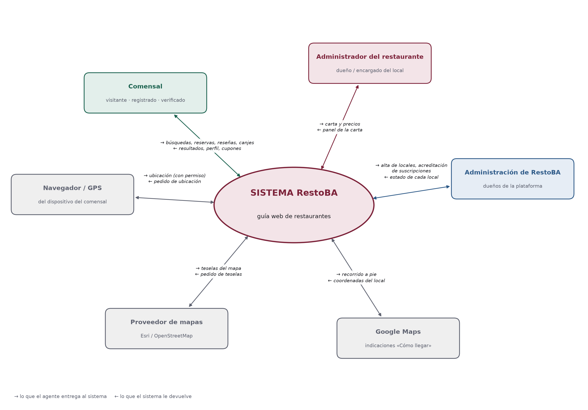
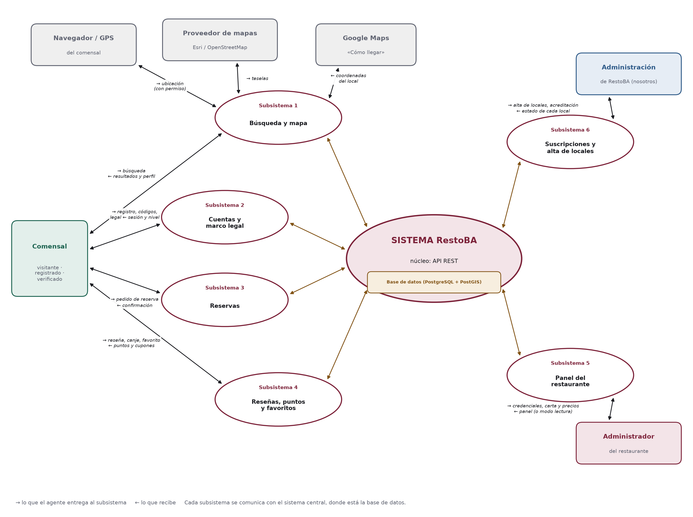
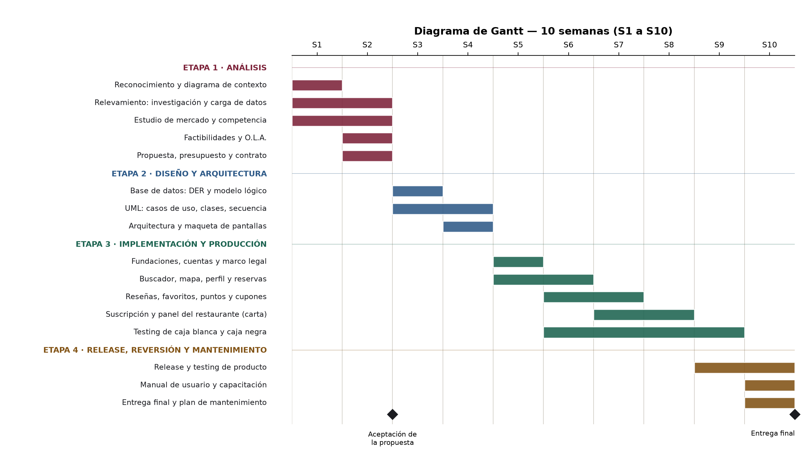
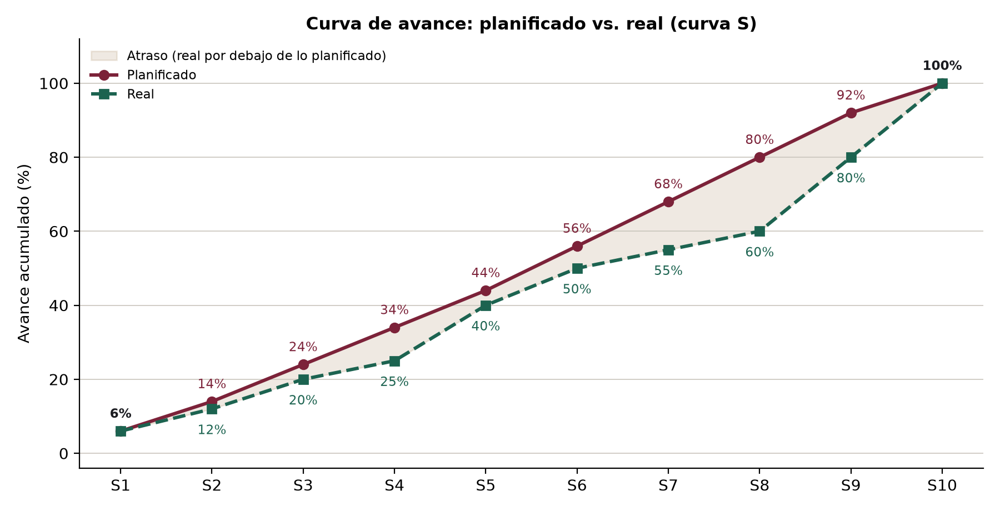

[← Introducción, resumen ejecutivo y alcance](01-introduccion.md) · [Índice](README.md) · [Etapa 2 — Diseño y arquitectura →](03-etapa-2-diseno.md)

---

# Etapa 1 — Análisis y factibilidad

**En esta página:** [1.1 Reconocimiento del problema y objetivos](#11-reconocimiento-del-problema-y-objetivos) · [1.2 Diagrama ambiental / modelo de contexto (límites del sistema)](#12-diagrama-ambiental--modelo-de-contexto-límites-del-sistema) · [1.3 Relevamiento de datos e investigación](#13-relevamiento-de-datos-e-investigación) · [1.4 Estudio de mercado y competencia](#14-estudio-de-mercado-y-competencia) · [1.5 Análisis de factibilidades](#15-análisis-de-factibilidades) · [1.6 O.L.A. — Objetivos, límites y alcances](#16-ola--objetivos-límites-y-alcances) · [1.7 Propuesta de valor, presupuesto comercial y contrato](#17-propuesta-de-valor-presupuesto-comercial-y-contrato) · [1.8 Planificación estratégica](#18-planificación-estratégica)

En esta etapa se reconoce el problema, se releva la información, se estudia el mercado y se comprueba que el proyecto es posible desde lo humano, lo técnico, lo económico y lo legal. Termina con la propuesta, el contrato y la planificación.

## 1.1 Reconocimiento del problema y objetivos

### Presentación del problema

Salir a comer tiene dos problemas que hoy no están bien resueltos.

**Del lado de las personas**, encontrar un buen lugar **cercano** y acorde a lo que se quiere comer (pastas, parrilla, pizza) sigue siendo difícil: la información está repartida entre Google Maps, Instagram y recomendaciones, sin la carta, precios ni reseñas actualizados que se sepa que son de gente que fue.

**Del lado de los restaurantes** —sobre todo los pequeños y medianos— cuesta darse a conocer y llenar el salón: no tienen un lugar donde mostrar su carta actualizada a la gente que está cerca y busca exactamente lo que ellos ofrecen.

> [!IMPORTANT]
> **Solución propuesta:** una guía web donde el comensal descubre restaurantes cercanos, ve la carta y reserva, y donde el restaurante aparece a cambio de una suscripción mensual. El restaurante mantiene su carta desde un panel simple.

### Objetivos

**Objetivo general.** Desarrollar una página web responsiva que permita a los comensales descubrir restaurantes cercanos por tipo de comida, ordenados por cercanía y puntaje, en la que los restaurantes aparecen pagando una suscripción mensual.

**Objetivos específicos.**

- Registro e inicio de sesión del comensal con tres niveles (visitante, registrado y verificado) y acceso separado para el administrador del restaurante.
- Buscador por tipo de comida con resultados por cercanía (geolocalización) y por puntaje.
- Perfil del restaurante con carta, horarios, ubicación y enlace «Cómo llegar».
- Reservas con disponibilidad real según horario y mesas.
- Reseñas ligadas a una visita real, favoritos y programa de puntos y cupones.
- Suscripción del restaurante: solo los locales con la suscripción al día aparecen en el buscador.
- Panel del restaurante para mantener su carta, con aislamiento total de datos entre locales (multiempresa).

## 1.2 Diagrama ambiental / modelo de contexto (límites del sistema)

### Diagrama de contexto de nivel 0

El diagrama de contexto muestra al **sistema como una sola caja** y, alrededor, a todos los **agentes exógenos**: las personas y los sistemas externos con los que intercambia información. Sirve para analizar quiénes son los usuarios, en qué medio interactúan y si hay una base de datos de por medio. Se hace en esta fase porque define el límite del sistema antes de diseñar nada.

Cada flecha es un intercambio en los dos sentidos: lo que el agente entrega al sistema (→) y lo que recibe (←). El diagrama está en la página siguiente.

Es un diagrama de **nivel 0 (caja negra)**: desde afuera solo importa qué datos entran y qué datos salen, no cómo se guardan. Por eso la **base de datos no aparece como agente**: está dentro del límite del sistema, el mismo criterio que se usa en los casos de uso.

*Figura 1. Diagrama de contexto de nivel 0 (caja negra) del sistema RestoBA.*

### Diagrama de contexto de nivel 1: subsistemas

El nivel 1 abre el sistema: entre el sistema central y cada agente externo aparece el **subsistema** por el que se comunican. Los agentes son los mismos del nivel 0, pero ya no se conectan con el sistema en general sino con un subsistema concreto. La **base de datos** aparece dentro del sistema central, como parte de su núcleo, porque en este nivel ya se mira hacia adentro.

- **Óvalo central:** El sistema **RestoBA** (el software en sí).
- **Rectángulos redondeados:** **Agentes externos** (personas o APIs que interactúan con el sistema).
- **Óvalos blancos:** **Subsistemas** (módulos internos en los que se divide el sistema).
- **Líneas marrones:** **Conexión interna** de cada subsistema con la base de datos central.

*Figura 2. Diagrama de contexto de nivel 1: subsistemas entre el sistema central y los agentes externos.*

| Subsistema | Qué hace | Agentes externos con los que se comunica |
| --- | --- | --- |
| **1 · Búsqueda y mapa** | Busca restaurantes por tipo de comida y cercanía, muestra el mapa y el perfil, y arma el enlace «Cómo llegar». | Comensal, Navegador / GPS, Proveedor de mapas, Google Maps |
| **2 · Cuentas y marco legal** | Registro, inicio de sesión, verificación de correo y teléfono y aceptación de los documentos legales. | Comensal |
| **3 · Reservas** | Calcula los turnos libres y confirma o cancela reservas. | Comensal |
| **4 · Reseñas, puntos y favoritos** | Publica reseñas de visitas reales, acredita y canjea puntos y guarda favoritos. | Comensal |
| **5 · Panel del restaurante** | Ingreso del administrador y gestión de la carta; modo lectura si la suscripción no está al día. | Administrador del restaurante |
| **6 · Suscripciones y alta de locales** | Da de alta los locales y registra la acreditación de cada período pagado. | Administración de RestoBA |

### Agentes exógenos

| Agente | Tipo | Entrega al sistema | Recibe del sistema |
| --- | --- | --- | --- |
| Comensal | Persona · usuario público | Búsquedas, ubicación, reservas, reseñas, canjes de puntos | Resultados por cercanía y puntaje, perfil y carta, confirmaciones, cupones |
| Administrador del restaurante | Persona · dueño o encargado del local | Carta y precios | Panel de la carta; aviso si la suscripción no está al día |
| Administración de RestoBA | Dueños de la plataforma (nosotros) | Alta de cada local (ficha, horarios, mesas) y acreditación de las suscripciones | Estado de suscripción de cada local |
| Navegador / GPS | Sistema externo | Ubicación del dispositivo (solo con permiso) | Pedido de ubicación |
| Proveedor de mapas | Sistema externo (Esri / OpenStreetMap) | Teselas del mapa | Pedido de teselas |
| Google Maps | Sistema externo | Recorrido a pie hasta el local | Coordenadas del restaurante («Cómo llegar») |

> [!NOTE]
> El pago de la suscripción **no pasa por el sistema**: el restaurante transfiere por banco, por fuera de la plataforma, y la administración de RestoBA registra la acreditación (Términos y Condiciones, art. 10). Por eso el banco no aparece como agente.

### Usuarios y medio en el que interactúan

| Usuario | Dónde y cuándo lo usa | Dispositivo | Conocimientos necesarios |
| --- | --- | --- | --- |
| Comensal | En la calle o en su casa, cuando decide dónde comer | Celular (principalmente) o PC | Uso básico del navegador del celular |
| Administrador del restaurante | En la oficina o la caja, fuera del horario de servicio, cuando cambia la carta o los precios | PC, notebook o celular | Conoce su carta; uso básico de formularios web |

## 1.3 Relevamiento de datos e investigación

El relevamiento es la **investigación y carga de datos**: de dónde sale la información que necesita el sistema, qué datos maneja, cómo se estructuran y quién los carga en cada local.

### Investigación: fuentes consultadas

| Fuente | Qué se relevó | Dónde se usa |
| --- | --- | --- |
| Documento de análisis del equipo (Etapa 1) | Actores, requerimientos funcionales y no funcionales, casos de uso y el DER inicial | Diseño de la base de datos y UML (Etapa 2) |
| Plataformas existentes: Morfy, Google Maps, TheFork | Qué datos muestran de cada restaurante (carta, horarios, puntaje, ubicación) y cómo se busca | Estructura de datos de este apartado y estudio de mercado (apartado 1.4) |
| Normativa: Ley 25.326 y Ley 24.240 | Qué datos personales se pueden pedir, con qué consentimiento y cómo se guardan | Marco legal propio, tablas de comensal y de aceptación legal |
| Documentación técnica de proveedores | Condiciones de los servicios de mapas: Google Maps exige tarjeta, CARTO pide clave desde 2025, Esri y OpenStreetMap no piden nada | Elección tecnológica (Etapa 2) |

> [!WARNING]
> No se aplicaron encuestas, cuestionarios ni entrevistas formales a comensales o restaurantes.

### Carga de datos

Para probar el prototipo se armó un juego de **datos de ejemplo**. Los restaurantes son ficticios, pero están ubicados en barrios reales de la Ciudad de Buenos Aires con sus coordenadas, así la búsqueda por cercanía funciona como en la realidad. Se cargan con un solo comando (`npm run db:seed`) y el script se niega a correr en producción.

| Dato cargado | Cantidad | Cómo se armó |
| --- | --- | --- |
| Restaurantes | 12 | Con dirección, barrio, coordenadas, horarios, rango de precio y tipos de cocina. Uno tiene la suscripción vencida, para comprobar que no aparece en el buscador. |
| Tipos de cocina | 13 | Pastas, parrilla, pizza, sushi, café de especialidad y otros. |
| Platos de la carta | 65 | Repartidos en secciones, con precio, descripción y etiquetas de vegetariano y sin TACC. |
| Mesas | 171 | 12 o 15 por local según su categoría de precio, de 2 a 8 personas. Las usa la reserva para saber si hay lugar. |
| Cuentas de administrador | 12 | Una por local, para entrar al panel de la carta. |
| Comensales | 10 | Con la cuenta verificada y el marco legal aceptado. |
| Reseñas | 59 | Ligadas a reservas cumplidas, algunas con respuesta del restaurante. |

### Estructura de datos relevada

A partir de las fuentes se identificaron los datos que el sistema tiene que guardar, quién los carga y con qué forma. Esta tabla es el insumo directo del diseño de la base de datos (Etapa 2).

| Dato | Contenido | Quién lo carga | Ejemplo |
| --- | --- | --- | --- |
| Restaurante | Nombre, dirección, barrio, ubicación, tipos de cocina, rango de precio, teléfono | Administración de RestoBA, al dar de alta el local | Cantina San Telmo · Pastas · $$ |
| Horarios | Día de la semana, hora de apertura y cierre (uno o dos turnos) | Administración de RestoBA, al dar de alta el local | Lunes 12:00–15:30 · 20:00–00:00 |
| Carta | Secciones y platos con precio, descripción, vegetariano, sin TACC | Administrador | Provoleta al orégano — $ 8.900 |
| Mesas | Número y capacidad (para calcular la disponibilidad de las reservas) | Administración de RestoBA, al dar de alta el local | Mesa 4 — 4 personas |
| Suscripción | Plan, período pagado, monto, comprobante y fecha de acreditación | Administración de RestoBA | Plan mensual — octubre — acreditada |
| Comensal | Nombre, correo, teléfono (cifrado), verificaciones | El propio comensal | — |
| Reservas | Fecha, hora y cantidad de personas | Comensal verificado | Sábado 21:00 — 4 personas |
| Reseñas | Puntuación de 1 a 5 y comentario | Comensal, después de la visita | 4 — «Muy buena pasta» |
| Puntos y cupones | Movimientos de puntos y cupones canjeados | El sistema, automáticamente | + puntos por reseña publicada |

## 1.4 Estudio de mercado y competencia

### Panorama

Las apps para descubrir dónde comer tienen enorme adopción y el software gastronómico en la nube es un mercado en crecimiento: el estudio del equipo lo estimó en unos **USD 6.600 millones a nivel mundial en 2025**, con un crecimiento anual cercano al **17 %**. RestoBA se ubica del lado del **descubrimiento**: una guía local donde los restaurantes pagan para aparecer.

### Competencia: ¿qué hay hecho?

| Competidor | Qué hace | Fortaleza | Debilidad que aprovechamos |
| --- | --- | --- | --- |
| Morfy | Descubrir dónde comer + beneficios. Cobra suscripción a los locales. | Competidor más directo; mapa por tipo de comida. | No se enfoca en reservas ni en reseñas ligadas a una visita real. |
| Google Maps | Buscador general con reseñas. | Lo usa todo el mundo. | Genérico: sin carta actualizada y con reseñas de cualquiera, aunque no haya ido. |
| TripAdvisor / TheFork | Reseñas y reservas online. | Marca fuerte en turismo. | Pensado para turismo; poco foco en los locales chicos del barrio. |

| Funcionalidad | Morfy | Google Maps | TheFork | RestoBA |
| --- | --- | --- | --- | --- |
| Buscador por cercanía y tipo de comida | Sí | Sí | Sí | **Sí** |
| Carta actualizada por el local | Parcial | No | Parcial | **Sí** |
| Reseñas | Sí | Sí | Sí | **Sí, ligadas a la visita** |
| Reservas | No es su foco | Por terceros | Sí | **Sí** |
| Fidelización | Descuentos | No | Parcial | **Puntos y cupones** |

### Historia de éxitos en casos similares

- **OpenTable (Estados Unidos, 1998):** empezó resolviendo las reservas online de los restaurantes y se convirtió en la referencia del sector; en 2014 lo compró el grupo Priceline (hoy Booking Holdings) en unos USD 2.600 millones. Enseñanza: el restaurante paga cuando la herramienta le llena mesas.
- **TheFork (Francia, 2007, como LaFourchette):** buscador para comensales con reservas online; TripAdvisor lo compró en 2014. Enseñanza: el comensal vuelve cuando encuentra en un solo lugar la carta, las reseñas y la reserva.
- **Morfy (Argentina):** creció ofreciendo descubrimiento y beneficios con un modelo B2B de suscripción. Enseñanza: el modelo de negocio funciona en el mercado local.

> [!IMPORTANT]
> **Oportunidad.** Ninguno ofrece, pensado para el mercado local, **buscador por cercanía + carta actualizada + reservas + reseñas de visitas reales + fidelización** en una sola web. Ese es el lugar de RestoBA, con una suscripción de precio claro para el restaurante y foco en los locales de barrio donde los grandes llegan poco.

## 1.5 Análisis de factibilidades

### Factibilidad humana (FODA interno)

Evalúa si el equipo puede llevar adelante el proyecto y si los usuarios van a poder usarlo. El FODA se hace sobre el equipo y el proyecto.

El FODA se organiza en **tres hilos conductores**

**hilo 1**, modelo de negocio (F1, D1, O1, A1); **hilo 2**, desarrollo técnico y validación (F2, D2, O2, A2); **hilo 3**, arquitectura de información y calidad (F3, D3, O3, A3).

Además, el FODA **está en constante cambio**.

**FODA del proyecto**

|   |   |
| --- | --- |
| **FORTALEZAS** (interno) | **DEBILIDADES** (interno) |
| • **F1** · Equipo de 5 integrantes enfocado en desarrollo web multiempresa y lógica de suscripciones. • **F2** · Dominio de TypeScript, Node.js y bases de datos geográficas (PostGIS). • **F3** · Metodología en cascada con aseguramiento de la calidad (SQA) en cada etapa. | • **D1** · Falta de experiencia comercial en venta de software y captación de clientes. • **D2** · Cronograma crítico, acotado a un plazo estricto de 10 semanas. • **D3** · Conocimiento técnico concentrado en pocos integrantes del equipo. |
| **OPORTUNIDADES** (externo) | **AMENAZAS** (externo) |
| • **O1** · Competencia consolidada (Morfy, Google Maps) sin reservas y fidelización integradas en una sola web. • **O2** · Validación temprana de la arquitectura con el prototipo funcional. • **O3** · Documento funcional completo y normalizado, que acelera la codificación de la base. | • **A1** · Restaurantes que no perciban el valor de pagar una suscripción mensual para aparecer. • **A2** · Cambios o inestabilidad en las APIs de mapas de terceros (Esri / OpenStreetMap). • **A3** · Desvíos del alcance por malas interpretaciones entre backend y frontend. |

**Cómo cambia cada elemento**

Cada elemento puede pasar al cuadrante opuesto. Una **fortaleza** que no se trabaja se vuelve **debilidad**, y una **debilidad** que se trabaja se vuelve **fortaleza**. Del lado externo, una **oportunidad** que no se aprovecha se vuelve **amenaza**, y una **amenaza** que se anticipa se vuelve **oportunidad**.

| Elemento | Qué pasa | En qué se convierte | Qué hacemos |
| --- | --- | --- | --- |
| **F1** · Equipo de 5 enfocado en desarrollo | Si no se trabaja | **Debilidad:** un grupo dividido que no sabe trabajar en conjunto, donde cada uno avanza por su lado. En el extremo, la división del equipo. | Reunión semanal, respetar la distribución del trabajo y avisar a tiempo si alguien se atrasa. |
| **D1** · Falta de experiencia comercial | Si se trabaja | **Fortaleza:** un equipo que sabe presentar el producto y conseguir sus primeros restaurantes. | Presentar el prototipo a restaurantes del barrio durante el testing de producto y preparar una propuesta de valor clara. |
| **O1** · Competencia sin reservas ni fidelización integradas | Si no se aprovecha | **Amenaza:** un competidor incorpora primero esas funciones y RestoBA pierde su diferencial. | Lanzar el MVP en plazo, con las reservas y los cupones como diferencial principal. |
| **A1** · Restaurantes que no ven el valor de pagar | Si se anticipa | **Oportunidad:** locales conformes que recomiendan la plataforma a otros restaurantes. | Ofrecer un primer período sin cargo y mostrarle a cada local las reservas que recibe. |
| **F2** · Dominio de TypeScript, Node.js y PostGIS | Si no se trabaja | **Debilidad:** conocimiento desactualizado o que queda en una sola persona. | Actualizar las herramientas del proyecto y que cada uno explique su parte al resto. |
| **D2** · Cronograma de 10 semanas | Si se trabaja | **Fortaleza:** un equipo entrenado para priorizar y entregar a tiempo. | Seguir el Gantt, medir el avance real cada semana con la curva S y construir primero lo crítico. |
| **O2** · Validación temprana con el prototipo | Si no se aprovecha | **Amenaza:** errores de diseño que aparecen recién en producción, cuando corregirlos cuesta más. | Probar el prototipo antes de cada entrega con los casos de prueba de la Etapa 3. |
| **A2** · Cambios en las APIs de mapas | Si se anticipa | **Oportunidad:** un sistema independiente de un único proveedor y sin costos de licencia. | Mantener los dos proveedores de mapas configurables (Esri y OpenStreetMap), sin claves de API. |
| **F3** · Cascada con SQA en cada etapa | Si no se trabaja | **Debilidad:** revisiones que se saltean y errores que pasan de una etapa a la siguiente. | No cerrar ninguna etapa sin su revisión SQA. |
| **D3** · Conocimiento concentrado en pocos | Si se trabaja | **Fortaleza:** cualquier integrante puede cubrir a otro si falta. | Revisiones de código por duplas y documentación al día. |
| **O3** · Documento funcional completo | Si no se aprovecha | **Amenaza:** un documento desactualizado que contradice al código. | Actualizarlo al cierre de cada etapa y registrarlo en el control de versiones. |
| **O3** · Documento funcional completo y normalizado | Si se aprovecha activamente y normalizado | **Fortaleza:** Un equipo con total claridad de diseño que codifica la base y las interfaces sin contradicciones ni retrabajos. | Usar el documento funcional como guía obligatoria en cada módulo y actualizarlo de forma conjunta al cierre de cada etapa. |
| **A3** · Desvíos entre backend y frontend | Si se anticipa | **Oportunidad:** un equipo alineado, donde cada requerimiento se puede seguir hasta su pantalla y su prueba. | Usar la matriz de trazabilidad (RF → CU → endpoint → prueba) y revisar los cambios entre duplas. |

> [!NOTE]
> El FODA se revisa en la **revisión SQA al cierre de cada etapa**: se mueve cada elemento al cuadrante que corresponda y se actualizan las acciones.

### Factibilidad técnica (requerimientos mínimo, estándar y óptimo)

Los recursos físicos no se dan por supuestos: se detallan para cada perfil de equipo.

**Computadoras del equipo de desarrollo**

| Componente | Mínimo | Estándar | Óptimo |
| --- | --- | --- | --- |
| Procesador | Core i3 / Ryzen 3 | Core i5 / Ryzen 5 | Core i7 / Ryzen 7 |
| Memoria RAM | 8 GB | 16 GB | 32 GB |
| Almacenamiento | 256 GB SSD | 512 GB SSD | 1 TB NVMe |
| Sistema operativo | Windows 10 / Linux / macOS con virtualización activada (Docker) | Windows 11 / Linux | Ídem estándar |
| Conexión | 10 Mbps | 50 Mbps | 100 Mbps o más |

**Servidor de producción (en la nube)**

| Componente | Mínimo | Estándar | Óptimo |
| --- | --- | --- | --- |
| CPU nucleos | 2 | 4 | 8 |
| Memoria RAM | 4 GB | 16 GB | 32 GB |
| Disco | 20 GB SSD | 40 GB SSD | 80 GB SSD + copias externas |
| Software | Linux + Docker + Node.js 22 | Ídem + copia diaria de la base | Ídem + réplica y monitoreo |

**Dispositivos de los usuarios**

| Dispositivo | Mínimo | Estándar | Óptimo |
| --- | --- | --- | --- |
| Celular del comensal | Android 8 / iOS 13, 2 GB de RAM, navegador actualizado, GPS | Android 11 / iOS 15, 4 GB de RAM | Gama alta reciente |
| PC o celular del administrador del restaurante | Cualquier dispositivo con navegador moderno | Notebook actual | — |

**Software base:** Node.js 22 o superior, Docker Desktop, PostgreSQL 16 con PostGIS 3.4 (en contenedor), Git y un navegador moderno (Chrome, Firefox, Edge o Safari). Todo el software base se usa bajo licencia de código abierto, sin costo de adquisición de software.

### Factibilidad económica

| Concepto | Detalle | Costo |
| --- | --- | --- |
| Servidor y base de datos | VPS en la nube (Hostinger) | $53.820 ARS por mes |
| Dominio | .com.ar | $22.500 ARS por año |
| Certificado SSL | Let's Encrypt | $0 · emisión automatizada sin costo |
| Software y librerías | Node.js, React, Express, PostgreSQL, PostGIS, Leaflet | Bajo licencia de código abierto sin costo de adquisición de software |
| Mapas | Esri / OpenStreetMap, sin clave | $0 · sujeto a políticas de uso justo |
| Notificaciones (simuladas) | Lógica interna: el código aparece en la página | $0 · no requiere API de terceros |

> [!NOTE]
> **Nota sobre licenciamiento y sostenibilidad tecnológica.** La arquitectura del sistema RestoBA maximiza la eficiencia de costos mediante el uso de componentes de código abierto (Open Source). El uso de librerías como Leaflet o entornos de ejecución como Node.js no devenga costos de licencias comerciales directas al inicio del proyecto. No obstante, se contempla en el plan de mantenimiento a mediano plazo la asignación de fondos destinados a donaciones a las fundaciones comunitarias (por ejemplo, OpenStreetMap Foundation), alineándose con las políticas de responsabilidad y gobernanza de la industria del software.

### Factibilidad legal

- **Datos personales — Ley 25.326.** Se manejan correo, teléfono y ubicación. La ubicación se pide solo con una acción explícita del usuario, nunca sola, y no se guarda. El teléfono se guarda cifrado (AES-256-GCM).
- **Defensa del consumidor — Ley 24.240.** Términos y Condiciones claros y moderación de reseñas para evitar contenido falso o difamatorio.
- **Marco legal propio:** Términos y Condiciones, Política de Privacidad, Acuerdo de Verificación y Anexo Técnico de Seguridad. El comensal los acepta para verificar su cuenta y la aceptación queda registrada con la versión y una huella del texto.
- **Pagos:** la plataforma no procesa pagos ni guarda datos de tarjetas o cuentas bancarias. La suscripción se paga por transferencia, por fuera del sistema (T&C, art. 10).
- **Fiscal:** inscripción ante ARCA para facturar las suscripciones. La facturación electrónica queda fuera de esta versión.
- **Licencias:** todas las librerías usadas son de código abierto y permiten uso comercial aunque con donaciones.

### Conclusión de factibilidad

| Factibilidad | Resultado | Fundamento |
| --- | --- | --- |
| Humano | **Viable** | Equipo de 5 con roles definidos; usuarios con conocimientos mínimos. |
| Técnica | **Viable** | Tecnologías maduras de código abierto, sin costo de licencia; requerimientos de hardware accesibles. |
| Económica | **Viable** | Los únicos costos son servicios de infraestructura medibles y bajos. |
| Legal | **Viable con condiciones** | Cumplimiento de la Ley 25.326, marco legal propio e inscripción fiscal. |

## 1.6 O.L.A. — Objetivos, límites y alcances

**Objetivo.** Desarrollar, en un plazo de ejecución estricto de 10 semanas, la plataforma web responsiva donde el comensal descubre restaurantes y reserva, y donde los restaurantes aparecen pagando una suscripción mensual.

**Límites** (restricciones operativas fuera del alcance del Producto Mínimo Viable o MVP):

- Funciona solo con conexión a internet.
- La precisión de las métricas de proximidad geográfica está supeditada a los permisos de geolocalización otorgados por el cliente web; sin ellos, la búsqueda ordena por puntaje.
- No procesa pagos: la suscripción se paga por transferencia, por fuera de la plataforma.
- No emite facturas electrónicas (ARCA).
- No se integra con apps de delivery (PedidosYa, Rappi).
- Los servicios de mensajería asincrónica (correo y SMS) se gestionan mediante emulación lógica local en el servidor, sin pasarela externa contratada en esta fase.

| Qué incluye | Qué NO incluye |
| --- | --- |
| • Módulo de gestión de usuarios con control de acceso basado en roles y estados (usuario anónimo/visitante, registro básico y perfil verificado) • Buscador por tipo de comida, cercanía y puntaje, con mapa • Perfil, carta y «Cómo llegar» • Reservas con disponibilidad real • Reseñas, favoritos, puntos y cupones • Suscripción del restaurante: solo aparecen los locales al día • Panel del restaurante para mantener la carta | • Mozos, cocina, pedidos, cobro e inventario (ver «Fuera de alcance») • Panel de administración de suscripciones: ver qué locales están al día y cuáles no (avance a futuro) • Aplicación móvil nativa (iOS/Android) • Pagos dentro de la plataforma • Módulo de facturación electrónica e integración fiscal con ARCA • Delivery • Autogestión avanzada del restaurante (edición de ficha, horarios e infraestructura de mesas, control de reservas en tiempo real y moderación activa de reseñas desde el panel de control) |

## 1.7 Propuesta de valor, presupuesto comercial y contrato

### Presentación del prototipo y de la solución

- **Maqueta navegable** de las pantallas principales (inicio, resultados, perfil, carta, reseña y aceptación del marco legal), para validar la interfaz antes de programar.
- **Prototipo funcional** que se levanta con un solo comando y trae datos de ejemplo cargados: se puede buscar, ver la carta, reservar, reseñar y canjear puntos; desde el panel, el restaurante actualiza su carta. Un local con la suscripción vencida no aparece en el buscador.
- **Solución:** una guía web multiempresa, sostenida por la suscripción de los restaurantes, con la seguridad declarada en un documento legal (Anexo Técnico de Seguridad).

### Presupuesto

El presente modelo económico detalla los costos asociados al despliegue y la operación inicial de la plataforma: la infraestructura y los servicios necesarios para tenerla en línea durante el primer año.

**Inversión en infraestructura tecnológica y operaciones (anual)**

| Concepto de infraestructura | Proveedor evaluado | Tipo de gasto | Importe anual (ARS) | Condición de licenciamiento |
| --- | --- | --- | --- | --- |
| Servidor VPS Cloud + base de datos (2 CPU, 4 GB RAM, extensión PostGIS) | Hostinger | Operativo (mensual × 12) | $645.840 | Contratación de servicio comercial de hosting. |
| Dominio institucional | Registro .com.ar | Fijo (anual) | $22.500 | Arancel de registro oficial de dominio web. |
| Certificado de seguridad SSL | Let’s Encrypt | Operativo | $0 | Sin costo de emisión, por automatización. |
| Motor de mapas y renderizado | Leaflet + Esri / OpenStreetMap | Operativo | $0 | Leaflet: licencia BSD, sin costo de adquisición. Teselas sin clave de API, sujetas a políticas de uso justo. |
| Pasarela de notificaciones (simulada) | Integrada en el backend | Desarrollo nativo | $0 | Lógica interna del sistema. No requiere API de terceros. |
| Fondo de contingencia operativa (10 %) | Reserva de riesgo | Preventivo | $66.834 | Reserva asignada para imprevistos o soporte técnico. |
| **Total costo operativo anual** | — | — | **$735.174** | — |

### Contrato

|   |   |
| --- | --- |
| **Partes** | Equipo RestoBA y **[datos del cliente]** |
| **Objeto** | Desarrollo de la plataforma RestoBA según el alcance definido en el O.L.A. de este documento. |
| **Plazo de entrega** | 10 semanas desde la aceptación de la propuesta. |
| **Hitos** | • H1, fin de S2: aceptación de la propuesta • H2, fin de S4: diseño aprobado • H3, fin de S8: prototipo completo • H4, fin de S10: entrega final |
| **Forma de pago** | Transferencia bancaria |
| **Garantía** | 30 días de garantía sin costo; pasado ese plazo, el soporte tiene costo |
| **Aceptación** | Se firma el acta de aceptación al aprobar las pruebas de producto (Etapa 4). |

Firma por el equipo: ______________________     Firma por el cliente: ______________________

## 1.8 Planificación estratégica

### Metodología

Se usa el modelo **en cascada con enfoque SQA**: las etapas avanzan en orden y cada una se cierra con una revisión de calidad antes de pasar a la siguiente. Se eligió cascada porque los requerimientos están claros desde el inicio y la cátedra exige documentar y cerrar cada etapa. Dentro de la Etapa 3 se construye por módulos, empezando por el lado del comensal.

### Diagrama de Gantt

El Gantt de la página siguiente reparte las cuatro etapas en las 10 semanas del proyecto, con dos hitos: la aceptación de la propuesta (fin de S2) y la entrega final (fin de S10).

*Figura 3. Diagrama de Gantt del proyecto (10 semanas)*

### Curvas de avance

La curva S muestra el avance acumulado planificado. Cada semana se carga el avance real en la tabla y se compara: si la curva real queda por debajo, el proyecto está atrasado.

El gráfico compara las dos curvas. El avance real quedó por debajo de lo planificado desde la semana 2; el mayor atraso fue en la semana 8 (60 % real contra 80 % planificado), y se recuperó en las semanas 9 y 10 hasta llegar al 100 %.

*Figura 4. Curva de avance: planificado vs. real (curva S).*

| Semana | S1 | S2 | S3 | S4 | S5 | S6 | S7 | S8 | S9 | S10 |
| --- | --- | --- | --- | --- | --- | --- | --- | --- | --- | --- |
| % planificado | 6 | 14 | 24 | 34 | 44 | 56 | 68 | 80 | 92 | 100 |
| % real | 6 | 12 | 20 | 25 | 40 | 50 | 55 | 60 | 80 | 100 |

### Riesgos

| Riesgo | Probabilidad | Impacto | Cómo se mitiga |
| --- | --- | --- | --- |
| Un integrante no puede seguir | Media | Alto | Documentación al día y código revisado por al menos dos personas. Ocurrió durante el proyecto: sus tareas se redistribuyeron entre los cinco integrantes restantes. |
| Atraso en la construcción | Media | Alto | Construir primero lo crítico (buscador, perfil y reservas) y dejar mejoras para mantenimiento. |
| Diferencias de entorno entre PCs | Alta | Medio | Base de datos en Docker con versión fija; arranque en un solo comando. |
| Fuga de datos personales | Baja | Muy alto | Cifrado del teléfono, contraseñas con bcrypt, SQL parametrizado, roles. |
| Cambio de un servicio externo (mapas) | Media | Medio | Dos proveedores de mapas configurables, sin clave de API. |

---

[← Introducción, resumen ejecutivo y alcance](01-introduccion.md) · [Índice](README.md) · [Etapa 2 — Diseño y arquitectura →](03-etapa-2-diseno.md)
