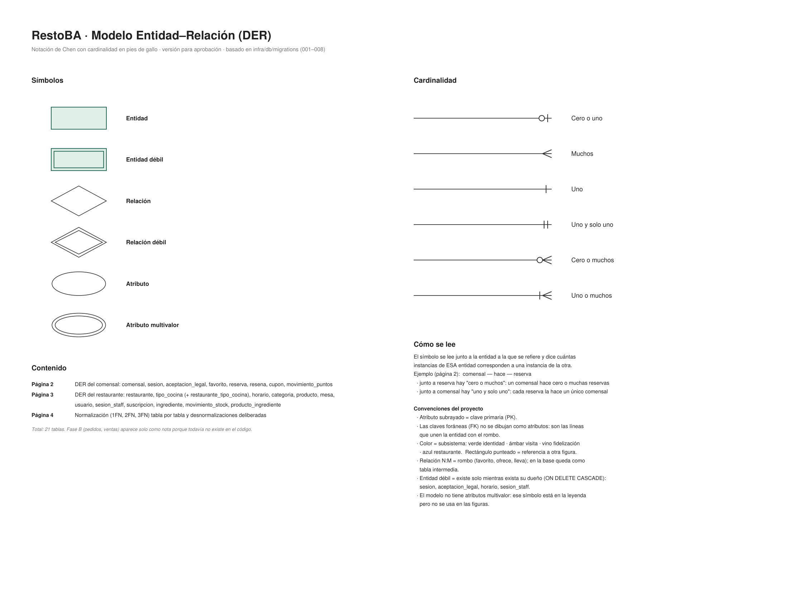
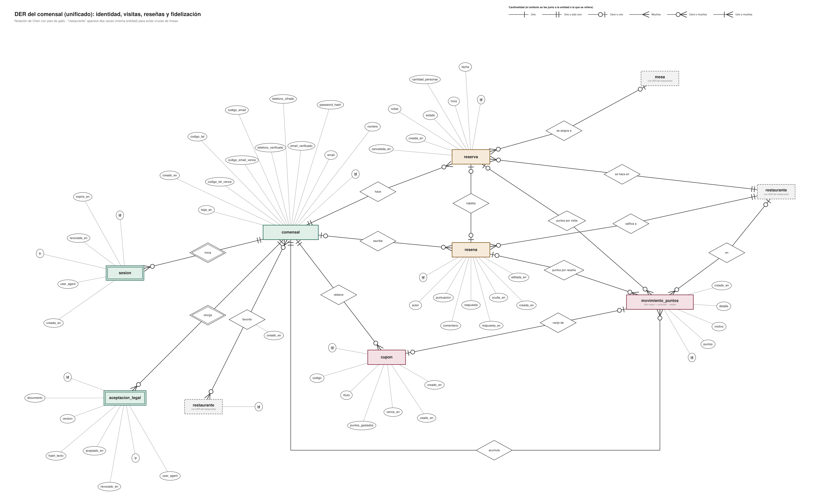
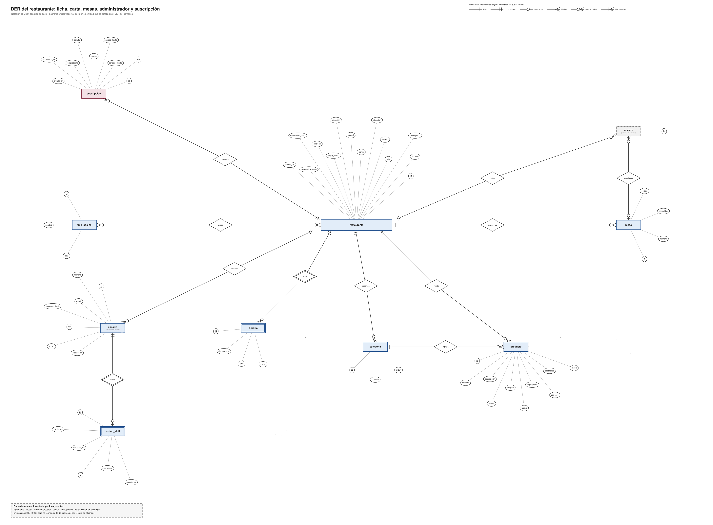
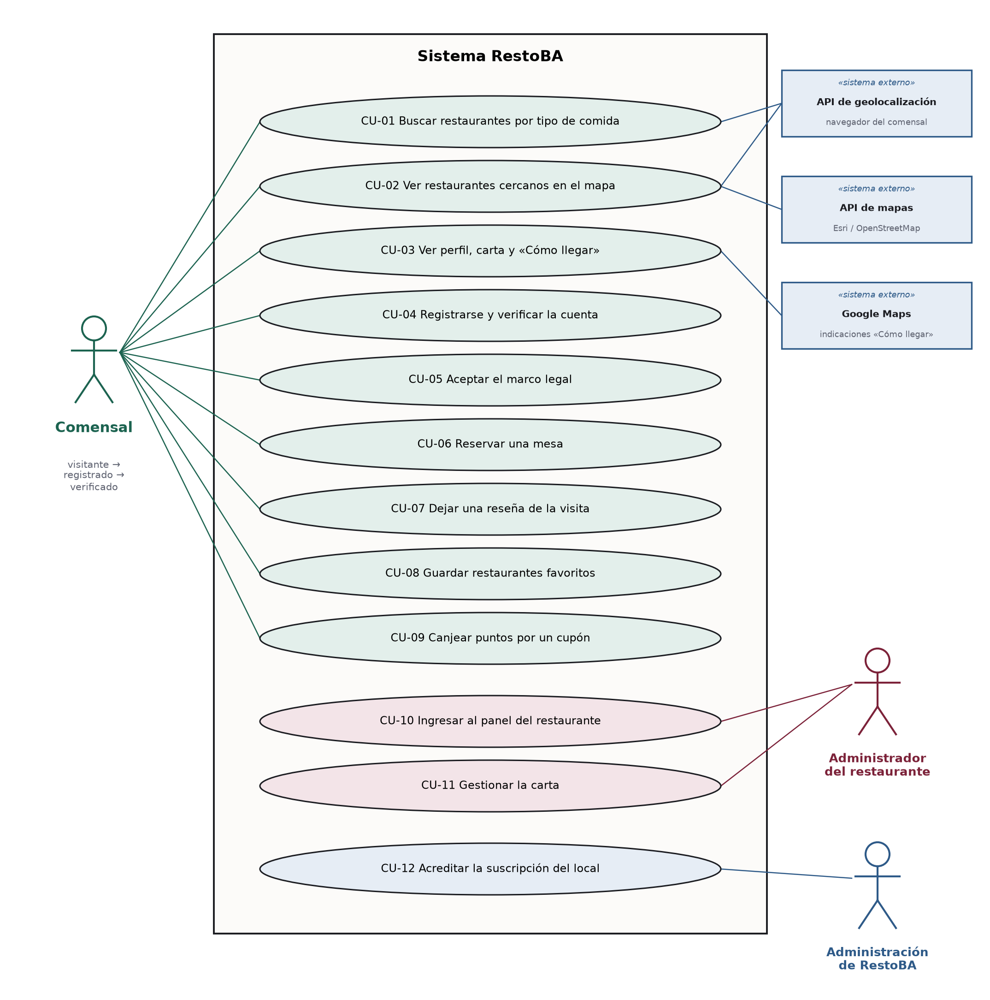
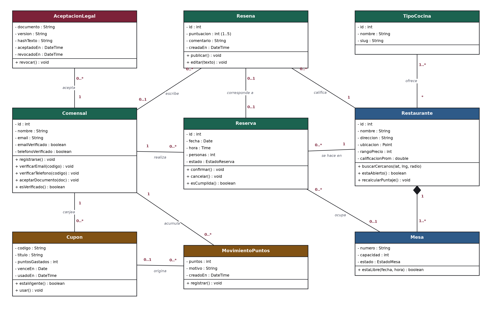
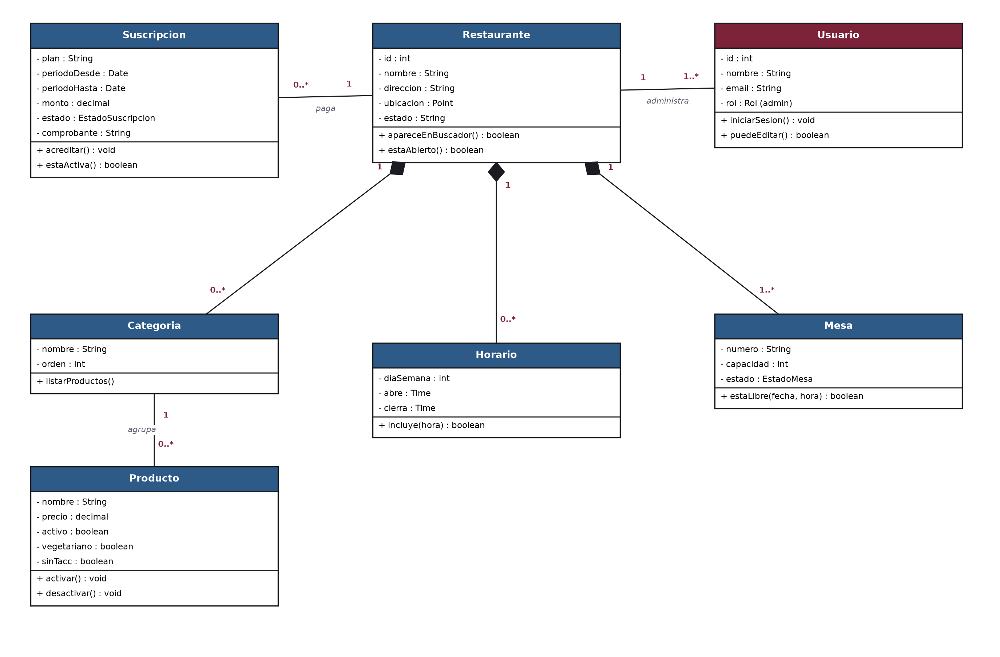
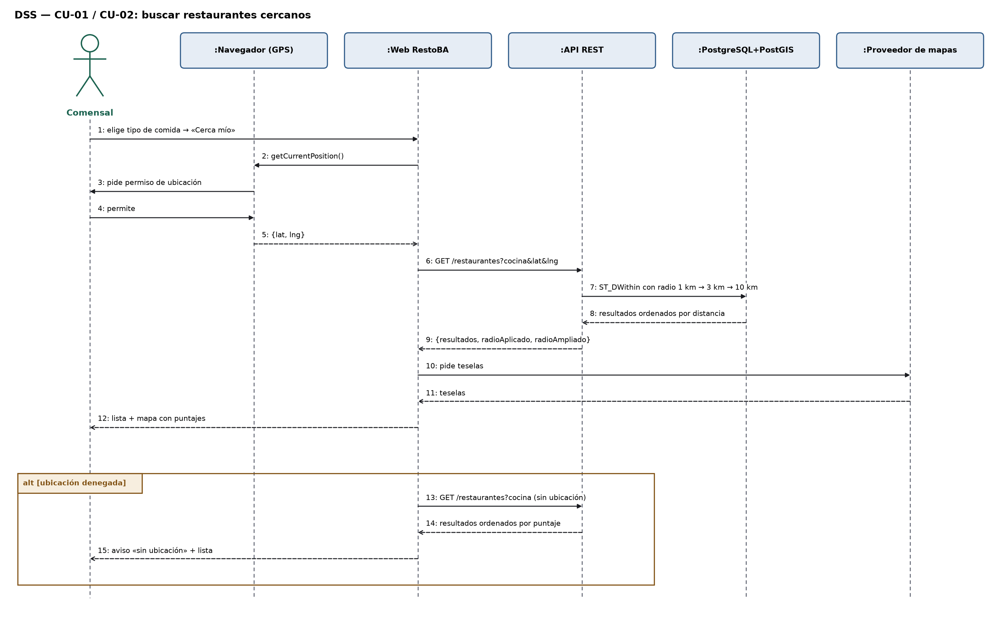
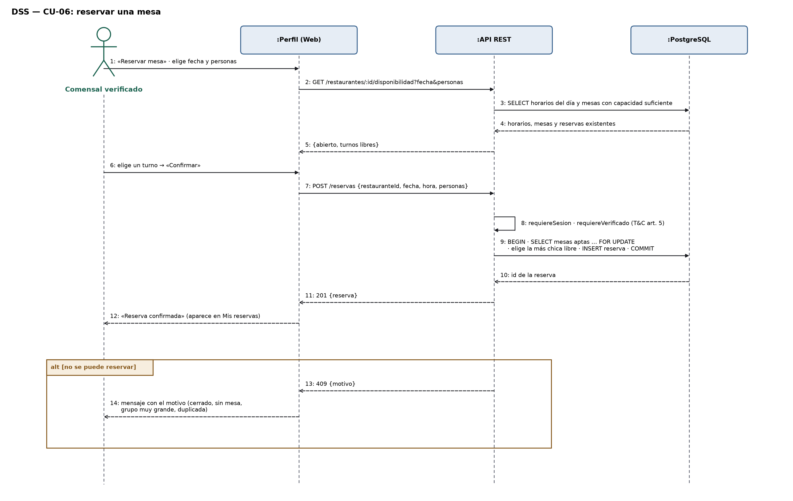
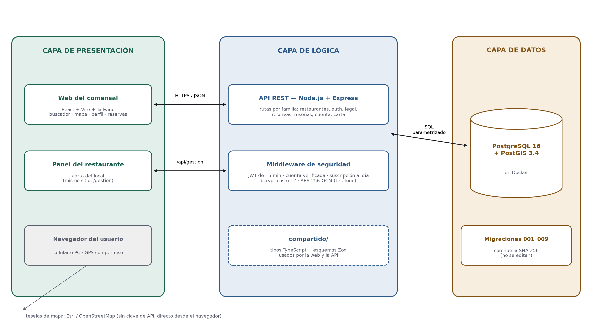

[← Etapa 1 — Análisis](02-etapa-1-analisis.md) · [Índice](README.md) · [Etapa 3 — Implementación y producción →](04-etapa-3-implementacion.md)

---

# Etapa 2 — Diseño y arquitectura

**En esta página:** [Fase 1 — Elección tecnológica](#fase-1--elección-tecnológica) · [Fase 2 — Diseño de la base de datos](#fase-2--diseño-de-la-base-de-datos) · [Fase 3 — Diseño UML](#fase-3--diseño-uml) · [Fase 4 — Arquitectura del sistema](#fase-4--arquitectura-del-sistema) · [Fase 5 — Diseño de interfaz](#fase-5--diseño-de-interfaz) · [Revisión SQA de la etapa: trazabilidad](#revisión-sqa-de-la-etapa-trazabilidad)

Con el problema analizado, en esta etapa se decide **con qué** se construye y **cómo** se organiza: la tecnología, la base de datos, los diagramas UML y la arquitectura.

## Fase 1 — Elección tecnológica

| Decisión | Elegido | Alternativas evaluadas | Por qué |
| --- | --- | --- | --- |
| Lenguaje de programación | TypeScript (JavaScript con tipos) | JavaScript puro, Python, PHP | Un solo lenguaje en la web y en el servidor; los tipos detectan errores antes de ejecutar. |
| Frontend (framework) | React 19 + Vite + Tailwind CSS | Angular, Vue | Componentes reutilizables y diseño responsivo rápido. |
| Backend (framework) | Node.js 22 + Express | Django, Laravel | Mismo lenguaje que el frontend; liviano para una API REST. |
| Base de datos | PostgreSQL 16 + PostGIS 3.4 | MySQL, MongoDB | PostGIS resuelve la cercanía dentro de la base con índices geográficos. |
| Validación compartida | Zod, en el paquete «compartido» | Validar a mano en cada lado | La web y la API usan exactamente las mismas reglas. |
| Mapas | Leaflet + Esri / OpenStreetMap | Google Maps, CARTO | Sin clave de API ni tarjeta de crédito. |
| Software (IDE) | Visual Studio Code | WebStorm | Gratuito y con soporte completo de TypeScript. |
| Otras herramientas | Git y GitHub, Docker, DBeaver, Postman, Figma, draw.io | — | Gratuitas y conocidas por el equipo. |
| Asistente de IA | Asistente de programación con IA | — | Acelera tareas repetitivas; todo lo que propone se revisa y se valida con compilación y pruebas. |

## Fase 2 — Diseño de la base de datos

### Reconocimiento del enunciado

El diseño de la base empieza por **analizar el enunciado del problema**. Se escribe en un párrafo qué hace el sistema y se marcan las palabras: los **sustantivos** se vuelven entidades (y luego clases u objetos), los **adjetivos** y características se vuelven atributos, y los **verbos** se vuelven relaciones (y luego métodos).

> [!NOTE]
> **Enunciado.** El **comensal** busca **restaurantes** cercanos según el **tipo de cocina** y los ve ordenados por distancia y puntaje. Cada restaurante tiene una **carta** organizada en **categorías** con **platos** que tienen precio, y **mesas** con una capacidad. Un comensal verificado **reserva** una mesa para una fecha y una hora y, después de la visita, deja una **reseña** con una puntuación. Por reservar y reseñar **acumula puntos** que **canjea** por **cupones**. El restaurante **paga** una **suscripción** mensual para **aparecer** en el buscador, y su **administrador** **mantiene** la carta desde un panel.

| Palabra del enunciado | Tipo | Se convierte en |
| --- | --- | --- |
| comensal, restaurante, tipo de cocina, categoría, plato, mesa, reserva, reseña, cupón, suscripción | Sustantivos | Entidades (tablas) y clases |
| administrador | Sustantivo (persona del local) | Entidad **usuario** (con atributo **rol**, que en este alcance es siempre «admin») |
| cercano, puntaje, precio, capacidad, fecha, hora, verificado, estado | Adjetivos y características | Atributos (ubicación, calificación, precio, capacidad…) |
| busca, tiene, reserva, deja, acumula, canjea, paga, aparece, mantiene | Verbos | Relaciones del DER y métodos de las clases |

### Notación de los DER

Los DER usan la notación de Chen (**rectángulo** = entidad, **rombo** = relación, **óvalo** = atributo) con la cardinalidad en **pies de gallo**. Como estaba planificado, el modelo está dividido en dos diagramas: el **DER del comensal** y el **DER del restaurante**. Así cada uno se puede leer completo y una actualización afecta a uno solo. Cuando una entidad aparece en los dos, se dibuja como rectángulo punteado con la referencia «ver DER del …».

*Figura 7. Símbolos, cardinalidad y convenciones de los DER.*

### DER del comensal

Identidad, visitas, reseñas y fidelización: comensal, sesión, aceptación legal, favorito, reserva, reseña, cupón y movimiento de puntos.

*Figura 8. DER del comensal.*

### DER del restaurante

Ficha, carta, mesas, administrador y suscripción: restaurante, tipo de cocina, horario, categoría, producto, mesa, usuario (administrador), sesión y suscripción. El inventario se quitó del diagrama porque quedó fuera de alcance.

*Figura 9. DER del restaurante.*

### Cardinalidades

La cardinalidad se lee **en las dos direcciones** y tiene un **mínimo** y un **máximo**:

- **Mínimo:** una tupla de la entidad A se puede relacionar **como mínimo** con tantas tuplas de la entidad B (0 si es opcional, 1 si es obligatoria).
- **Máximo:** una tupla de la entidad A se puede relacionar **como máximo** con tantas tuplas de la entidad B (1 o N).

En los DER el símbolo de pies de gallo **se lee junto a la entidad a la que se refiere**: dice cuántas instancias de esa entidad corresponden a una instancia de la otra. Por ejemplo, en comensal — hace — reserva, junto a reserva está «cero o muchos» (un comensal hace cero o muchas reservas) y junto a comensal está «uno y solo uno» (cada reserva la hace un único comensal).

| Relación | Lectura de A hacia B | Lectura de B hacia A | Tipo |
| --- | --- | --- | --- |
| Comensal hace Reserva | Un comensal hace mín. 0 y máx. N reservas | Una reserva la hace mín. 1 y máx. 1 comensal | 1:N |
| Reserva se asigna a Mesa | Una reserva se asigna a mín. 0 y máx. 1 mesa | Una mesa recibe mín. 0 y máx. N reservas | N:1 |
| Comensal escribe Reseña | Un comensal escribe mín. 0 y máx. N reseñas | Una reseña es de mín. 0 y máx. 1 comensal (si se da de baja, la reseña queda) | 1:N |
| Comensal favorito Restaurante | Un comensal guarda mín. 0 y máx. N restaurantes | Un restaurante es guardado por mín. 0 y máx. N comensales | N:M |
| Comensal obtiene Cupón | Un comensal obtiene mín. 0 y máx. N cupones | Un cupón es de mín. 1 y máx. 1 comensal | 1:N |
| Restaurante dispone de Mesa | Un restaurante dispone de mín. 0 y máx. N mesas | Una mesa pertenece a mín. 1 y máx. 1 restaurante | 1:N |
| Restaurante ofrece Tipo de cocina | Un restaurante ofrece mín. 0 y máx. N tipos | Un tipo es ofrecido por mín. 0 y máx. N restaurantes | N:M |
| Categoría agrupa Producto | Una categoría agrupa mín. 0 y máx. N platos | Un plato está en mín. 1 y máx. 1 categoría | 1:N |
| Restaurante contrata Suscripción | Un restaurante contrata mín. 0 y máx. N suscripciones (una por período) | Una suscripción es de mín. 1 y máx. 1 restaurante | 1:N |
| Restaurante emplea Usuario | Un restaurante tiene mín. 0 y máx. N usuarios (en este alcance, su administrador) | Un usuario es de mín. 1 y máx. 1 restaurante | 1:N |

### Modelo lógico (relacional)

Cada entidad se convierte en una tabla; las relaciones 1:N se resuelven con una clave foránea del lado N, y las N:M con una tabla intermedia. El alcance del proyecto usa **18 tablas**, creadas por las migraciones 002 a 007.

| Tabla | Clave primaria | Claves foráneas | Atributos principales |
| --- | --- | --- | --- |
| restaurante | id | — | nombre, descripcion, plan, estado, direccion, barrio, ciudad, ubicacion (geography), rango_precio, telefono, calificacion_prom, cantidad_resenas |
| tipo_cocina | id | — | nombre, slug |
| restaurante_tipo_cocina | (restaurante_id, tipo_cocina_id) | restaurante, tipo_cocina | — |
| horario | id | restaurante_id | dia_semana, abre, cierra |
| categoria | id | restaurante_id | nombre, orden |
| producto | id | restaurante_id, categoria_id | nombre, descripcion, precio, imagen, activo, vegetariano, sin_tacc, destacado, orden |
| comensal | id | — | nombre, email, password_hash, email_verificado, telefono_cifrado, telefono_verificado, creado_en, baja_en |
| sesion | id (UUID) | comensal_id | expira_en, revocada_en, ip, user_agent |
| aceptacion_legal | id | usuario_id → comensal | documento, version, hash_texto, aceptado_en, revocado_en |
| mesa | id | restaurante_id | numero, capacidad, estado |
| reserva | id | restaurante_id, comensal_id, mesa_id | fecha, hora, cantidad_personas, estado, notas, cancelada_en |
| resena | id | restaurante_id, comensal_id, reserva_id | autor, puntuacion, comentario, respuesta, creada_en |
| favorito | (comensal_id, restaurante_id) | comensal, restaurante | creado_en |
| cupon | id | comensal_id | codigo, titulo, puntos_gastados, vence_en, usado_en |
| movimiento_puntos | id | comensal_id, restaurante_id, reserva_id, resena_id, cupon_id | puntos, motivo, detalle, creado_en |
| usuario | id | restaurante_id | nombre, email, password_hash, rol, activo |
| sesion_staff | id (UUID) | usuario_id | expira_en, revocada_en, ip, user_agent |
| suscripcion | id | restaurante_id | plan, periodo_desde, periodo_hasta, monto, estado, comprobante, acreditada_en |

> [!NOTE]
> En el código existen además seis tablas que quedaron **fuera de alcance**: **ingrediente**, **producto_ingrediente** y **movimiento_stock** (migración 008, inventario) y **pedido**, **item_pedido** y **venta** (migración 009, salón y cocina). No se borran porque las migraciones aplicadas no se editan, pero no forman parte de este proyecto.

### Diccionario de datos (tablas centrales del alcance)

**restaurante**

| Campo | Tipo | Restricción | Descripción |
| --- | --- | --- | --- |
| id | SERIAL | PK | Identificador del local |
| nombre | VARCHAR(120) | NOT NULL | Nombre comercial |
| estado | VARCHAR(24) | activa · pendiente_acreditacion · vencida · cancelada | Estado de la suscripción: solo «activa» aparece en el buscador |
| direccion / barrio / ciudad | VARCHAR | dirección obligatoria | Ubicación escrita |
| ubicacion | geography(Point, 4326) | NOT NULL, índice GIST | Punto en el mapa para buscar por cercanía |
| rango_precio | SMALLINT | entre 1 y 3 | Se muestra como $, $$ o $$$ |
| calificacion_prom | NUMERIC(2,1) | NULL o entre 1 y 5 | Promedio de reseñas |

**suscripcion**

| Campo | Tipo | Restricción | Descripción |
| --- | --- | --- | --- |
| id | SERIAL | PK | Identificador del período |
| restaurante_id | INTEGER | NOT NULL, FK → restaurante, CASCADE | Local que paga |
| plan | VARCHAR | NOT NULL | Plan contratado |
| periodo_desde / periodo_hasta | DATE | NOT NULL | Período que cubre el pago |
| monto | NUMERIC | NOT NULL | Importe transferido |
| estado | VARCHAR(24) | por defecto 'pendiente_acreditacion' | Pasa a acreditada cuando la administración de RestoBA confirma la transferencia |
| comprobante | VARCHAR | opcional | Referencia del comprobante de transferencia |
| acreditada_en | TIMESTAMPTZ | opcional | Momento de la acreditación manual |

**reserva**

| Campo | Tipo | Restricción | Descripción |
| --- | --- | --- | --- |
| id | SERIAL | PK | Identificador de la reserva |
| restaurante_id | INTEGER | NOT NULL, FK → restaurante, CASCADE | Local reservado |
| comensal_id | INTEGER | NOT NULL, FK → comensal, CASCADE | Quién reserva (debe estar verificado) |
| mesa_id | INTEGER | FK → mesa, SET NULL | Mesa asignada: la más chica donde entra el grupo |
| fecha / hora | DATE / TIME | NOT NULL | Turno reservado |
| cantidad_personas | SMALLINT | NOT NULL | Tamaño del grupo |
| estado | VARCHAR(16) | por defecto 'confirmada' | confirmada, cancelada o cumplida |

### Normalización (1FN, 2FN y 3FN)

Se verificó cada tabla de las migraciones contra las tres formas normales; los DER reflejan la base tal como está, sin tablas inventadas.

**Criterio aplicado**

| Forma normal | Condición | Cómo se verificó |
| --- | --- | --- |
| 1FN | Valores atómicos, sin grupos repetidos, toda tabla con clave primaria. | Ningún campo guarda listas: los horarios van en **horario** (una fila por día) y los tipos de cocina en la tabla intermedia. Todas las tablas tienen PK. |
| 2FN | 1FN + ningún atributo depende de solo una parte de una clave compuesta. | Solo 2 tablas del alcance tienen PK compuesta: **favorito** y **restaurante_tipo_cocina**; ninguna tiene atributos que dependan de una parte de la clave. Cumple. |
| 3FN | 2FN + ningún atributo no clave depende de otro atributo no clave (sin dependencias transitivas). | Se revisó columna por columna; el resultado está abajo. |

**Cómo se resolvieron las relaciones muchos a muchos**

| Relación N:M | Tabla intermedia | PK | Atributos propios |
| --- | --- | --- | --- |
| comensal ↔ restaurante (favoritos) | favorito | (comensal_id, restaurante_id) | creado_en |
| restaurante ↔ tipo_cocina | restaurante_tipo_cocina | (restaurante_id, tipo_cocina_id) | — |

**Dependencias evitadas con tablas separadas.** Los datos del restaurante no se repiten en cada producto o mesa: **categoria**, **producto**, **mesa**, **horario**, **usuario** y **suscripcion** guardan solo la clave `restaurante_id`. Lo mismo con el comensal: **sesion**, **cupon**, **reserva**, **resena** y **movimiento_puntos** guardan `comensal_id` y no copian nombre ni email. Los tipos de cocina son una tabla aparte (**tipo_cocina**), no un texto repetido.

**Redundancias que se mantienen a propósito (desnormalización justificada)**

| Dónde | Qué se repite o se deriva | Por qué se acepta |
| --- | --- | --- |
| restaurante.calificacion_prom, cantidad_resenas | Se pueden calcular desde **resena**. | El buscador ordena y filtra por calificación; recalcular el promedio en cada búsqueda sería costoso. Se actualiza al crear, editar u ocultar una reseña. |
| resena.autor | Copia el nombre del comensal. | Si el comensal se da de baja, `comensal_id` pasa a NULL y la reseña queda publicada anonimizada; el nombre se congela a propósito. |
| resena.restaurante_id | Se obtiene también por reserva_id → reserva.restaurante_id. | `reserva_id` puede ser NULL; sin esta columna, una reseña sin reserva no sabría de qué local es. |
| movimiento_puntos.restaurante_id | Derivable desde reserva o reseña. | Se conserva aunque la reserva desaparezca: el libro mayor de puntos tiene que poder auditarse solo. |
| restaurante.plan / estado y suscripcion.plan / estado | Mismo dato en dos tablas. | **restaurante** guarda el estado vigente que usa el buscador; **suscripcion** guarda el historial de períodos pagados. |

**Dependencia transitiva detectada (única violación de 3FN).** En **aceptacion_legal**, `hash_texto` depende de (documento, version) y no de la clave `id`: el mismo hash se repite en cada aceptación de esa versión. Normalizado, sería una tabla **documento_legal** (documento, version, hash_texto) y la aceptación apuntaría a ella. No se dibujó así porque el DDL de esa tabla viene fijado por el marco legal y el código lo usa tal cual; queda como mejora opcional y se deja documentada acá. Otro caso menor: en **restaurante**, `ciudad` tiene valor por defecto y el proyecto opera solo en CABA, por lo que barrio → ciudad no genera inconsistencias reales.

**Conclusión.** El modelo está en **3FN** salvo la dependencia de `hash_texto` señalada. Las demás redundancias son decisiones de diseño con motivo funcional (rendimiento del buscador, anonimización, auditoría), no errores de normalización.

## Fase 3 — Diseño UML

### Requerimientos funcionales

Los requerimientos funcionales describen **qué hace el sistema** e interactúan con la base de datos. Se clasifican en **críticos** (sin ellos el sistema no cumple su objetivo) y **no críticos**.

| ID | Requerimiento | Actor | Prioridad | Estado |
| --- | --- | --- | --- | --- |
| RF-01 | Registro e inicio de sesión del comensal con niveles, e ingreso del administrador al panel | Comensal, administrador | Crítico | Implementado |
| RF-02 | Buscar restaurantes por tipo de comida | Comensal | Crítico | Implementado |
| RF-03 | Mostrar restaurantes cercanos en el mapa | Comensal | Crítico | Implementado |
| RF-04 | Ordenar y filtrar por cercanía, puntaje y precio | Comensal | No crítico | Implementado |
| RF-05 | Ver perfil del restaurante: carta, horarios, «Cómo llegar» | Comensal | Crítico | Implementado |
| RF-06 | Dejar reseñas ligadas a una visita | Comensal | No crítico | Implementado |
| RF-07 | Reservar mesa con disponibilidad real | Comensal | Crítico | Implementado |
| RF-08 | Gestionar la carta del restaurante | Administrador | Crítico | Implementado |
| RF-09 | Mostrar en el buscador solo los locales con la suscripción al día | Sistema | Crítico | Implementado |
| RF-10 | Acreditar la suscripción del local | Administración de RestoBA | Crítico | Sin pantalla: en el prototipo se hace en la base |
| RF-11 | Aislar los datos de cada restaurante | Sistema | Crítico | Implementado |
| RF-12 | Favoritos, puntos y cupones | Comensal | No crítico | Implementado |

### Requerimientos no funcionales

Describen **cómo** tiene que comportarse el sistema y orientan el diseño y el desarrollo.

| ID | Requerimiento | Cómo se cumple |
| --- | --- | --- |
| RNF-01 | Usabilidad: web responsiva | Diseño pensado primero para celular, que es como el comensal busca dónde comer. |
| RNF-02 | Rendimiento en la búsqueda | La cercanía se resuelve en la base con índice GIST y `ST_DWithin`; radios en escalera (1, 3 y 10 km); pool de conexiones. |
| RNF-03 | Disponibilidad ≥ 99 % | Servidor en la nube con reinicio automático y copias de la base. |
| RNF-04 | Seguridad | Contraseñas con bcrypt (costo 12), sesiones JWT de 15 minutos, teléfono cifrado con AES-256-GCM, SQL parametrizado, cabeceras de seguridad y control del nivel del comensal y de la sesión del administrador en el servidor. |
| RNF-05 | Compatibilidad | Navegadores modernos en Android, iOS, Windows, Linux y macOS. |
| RNF-06 | Escalabilidad | API sin estado y multiempresa; cambios de base por migraciones numeradas. |

### Diagrama de casos de uso

El diagrama muestra los 12 casos de uso del sistema y los actores que participan: el **comensal** (con sus tres niveles), el **administrador del restaurante**, que mantiene la carta, y la **administración de RestoBA**, que acredita la suscripción con la que el local aparece en la guía.

Además, siguiendo el criterio de la cátedra, **toda API externa que pide o envía información al sistema también es un actor**. A la derecha del diagrama están los tres actores secundarios (sistemas externos) que participan en los casos de uso del comensal. La base de datos no es un actor: es parte del sistema.

| Actor secundario | Qué intercambia con el sistema | Casos de uso |
| --- | --- | --- |
| API de geolocalización del navegador | Entrega la ubicación del comensal, solo si él da permiso | CU-01, CU-02 |
| API de mapas (Esri / OpenStreetMap) | Recibe el pedido de teselas y devuelve las imágenes del mapa | CU-02 |
| Google Maps | Recibe las coordenadas del restaurante y muestra el recorrido a pie («Cómo llegar») | CU-03 |

*Figura 10. Diagrama de casos de uso.*

### Tabla de casos de uso

| CU | Nombre | Actor | Propósito |
| --- | --- | --- | --- |
| CU-01 | Buscar restaurantes por tipo de comida | Comensal · API de geolocalización | Encontrar dónde comer según lo que quiere |
| CU-02 | Ver restaurantes cercanos en el mapa | Comensal · API de geolocalización · API de mapas | Ver qué tiene cerca y a qué distancia |
| CU-03 | Ver perfil, carta y «Cómo llegar» | Comensal · Google Maps | Decidir y llegar al local |
| CU-04 | Registrarse y verificar la cuenta | Comensal | Pasar de visitante a usuario verificado |
| CU-05 | Aceptar el marco legal | Comensal | Dejar constancia de la aceptación de los documentos |
| CU-06 | Reservar una mesa | Comensal verificado | Asegurarse un lugar |
| CU-07 | Dejar una reseña de la visita | Comensal verificado | Calificar un local donde estuvo |
| CU-08 | Guardar restaurantes favoritos | Comensal registrado | Volver a encontrarlos rápido |
| CU-09 | Canjear puntos por un cupón | Comensal verificado | Obtener un beneficio |
| CU-10 | Ingresar al panel del restaurante | Administrador del restaurante | Acceder al panel de su local |
| CU-11 | Gestionar la carta | Administrador del restaurante | Mantener secciones, platos y precios |
| CU-12 | Acreditar la suscripción del local | Administración de RestoBA | Confirmar el pago para que el local aparezca en el buscador |

### Casos de uso detallados

Para los casos de uso más importantes se detalla el propósito, el flujo principal y las **excepciones** (lo que puede salir mal y cómo responde el sistema).

**CU-01 — Buscar restaurantes por tipo de comida**

|   |   |
| --- | --- |
| **Actores** | Comensal (principal; cualquier nivel, incluso visitante) · API de geolocalización del navegador (secundario) |
| **Propósito** | Encontrar restaurantes de un tipo de comida, ordenados por cercanía y puntaje. |
| **Precondición** | Ninguna. |
| **Flujo principal** | 1. El comensal elige el tipo de comida y toca «Cerca mío». 2. El navegador pide permiso de ubicación y el comensal lo da. 3. El sistema busca dentro de 1 km; si no hay resultados, amplía a 3 km y luego a 10 km, y avisa que amplió. 4. Muestra la lista y el mapa con el puntaje de cada local. |
| **Excepciones** | • Ubicación denegada: la búsqueda sigue ordenada por puntaje y se avisa. • Sin resultados aun a 10 km: mensaje y sugerencia de otro tipo de comida. • Local con la suscripción vencida: no aparece. |
| **Postcondición** | El comensal ve los resultados; la ubicación no se guarda. |

**CU-06 — Reservar una mesa**

|   |   |
| --- | --- |
| **Actor** | Comensal verificado |
| **Propósito** | Asegurarse un lugar para una fecha, una hora y una cantidad de personas. |
| **Precondición** | Correo y teléfono verificados y los tres documentos legales aceptados. |
| **Flujo principal** | 1. En el perfil toca «Reservar mesa». 2. Elige fecha y cantidad de personas. 3. El sistema muestra los horarios libres según los horarios del local y sus mesas. 4. Elige un horario y confirma. 5. El sistema asigna la mesa más chica donde entra el grupo, dentro de una transacción, y confirma. |
| **Excepciones** | • No está verificado: se lo lleva a verificar la cuenta. • El local no atiende ese día. • No quedan turnos para ese grupo. • El grupo es más grande que cualquier mesa. • Otra persona tomó el último turno en el mismo momento: «turno no disponible». • Ya tiene una reserva igual: reserva duplicada. |
| **Postcondición** | La reserva queda confirmada y aparece en «Mis reservas». |

**CU-11 — Gestionar la carta**

|   |   |
| --- | --- |
| **Actor** | Administrador del restaurante |
| **Propósito** | Mantener actualizadas las secciones, los platos y los precios que ve el comensal. |
| **Precondición** | Sesión de administrador iniciada en /gestion. |
| **Flujo principal** | 1. Entra a «Carta». 2. Crea o edita una sección (nombre y orden). 3. Crea o edita un plato: nombre, descripción, precio y etiquetas (vegetariano, sin TACC, destacado). 4. Guarda: el cambio se ve enseguida en el perfil público del local. |
| **Excepciones** | • Suscripción no activa: el panel queda en modo lectura y no deja guardar. • Datos inválidos (por ejemplo, precio negativo): se rechaza con el mensaje del campo. • La sección o el plato es de otro local: «no encontrado». |
| **Postcondición** | La carta pública muestra los datos nuevos. |

**CU-12 — Acreditar la suscripción del local**

|   |   |
| --- | --- |
| **Actor** | Administración de RestoBA |
| **Propósito** | Confirmar que el restaurante pagó, para que aparezca en el buscador. |
| **Precondición** | El restaurante transfirió el importe del período por fuera de la plataforma (T&C, art. 10). |
| **Flujo principal** | 1. La administración verifica la transferencia en el banco. 2. Registra el período pagado con su comprobante y la fecha de acreditación. 3. El estado del local pasa a «activa» y empieza a aparecer en las búsquedas. |
| **Excepciones** | • Período vencido sin pago: el local pasa a «vencida» y deja de aparecer en el buscador; su panel queda en modo lectura. |
| **Postcondición** | El local aparece en el buscador hasta el fin del período pagado. |
| **Nota** | En el prototipo no hay pantalla para este caso de uso: la acreditación se registra directamente en la base de datos. |

### Diagrama de clases

Un **objeto** representa un elemento, unidad o entidad individual e identificable; una **clase** es el molde de esos objetos. El diagrama de clases sale mayormente de la base de datos (el «molde» de los objetos): cada clase tiene su nombre, sus **atributos** (privados, con «−») y sus **métodos** (públicos, con «+»). Las líneas son asociaciones con su **multiplicidad** en cada extremo; el rombo negro es **composición** (la parte no existe sin el todo: una mesa no existe sin su restaurante). El diagrama del restaurante muestra solo las clases del alcance.

Se presenta en dos partes para que se pueda leer: el lado del comensal y el lado del restaurante.

*Figura 11. Diagrama de clases — lado del comensal.*

*Figura 12. Diagrama de clases — lado del restaurante.*

### Diagramas de secuencia (DSS)

El diagrama de secuencia muestra, en orden temporal, los **mensajes** que intercambian un **actor** y las **instancias** del sistema para cumplir un caso de uso. Las flechas llenas son llamadas y las punteadas son respuestas. Los recuadros **loop** (repetición) y **alt** (alternativa) marcan partes que se repiten o que ocurren solo si se cumple una condición.

*Figura 13. DSS de CU-01 y CU-02: buscar restaurantes cercanos.*

*Figura 14. DSS de CU-06: el comensal reserva una mesa.*

## Fase 4 — Arquitectura del sistema

Arquitectura **cliente–servidor en tres capas**, con una única API REST que atiende tanto al comensal como al administrador del restaurante.

- **Presentación:** una sola web en React. El lado del comensal y el panel del restaurante (/gestion) son dos «mundos» con sesiones separadas.
- **Lógica:** API REST en Node.js + Express. Cada ruta valida los datos con los mismos esquemas que usa la web y aplica los controles de sesión, nivel del comensal y suscripción del local.
- **Datos:** PostgreSQL + PostGIS en Docker. Todo el acceso pasa por un único pool de conexiones y con consultas parametrizadas.
- **Multiempresa:** el restaurante de cada consulta sale siempre del usuario que inició sesión, nunca de lo que manda el navegador. Por eso un local no puede ver datos de otro cambiando un número en la dirección.

*Figura 15. Arquitectura en tres capas.*

## Fase 5 — Diseño de interfaz

Antes de programar se armó una **maqueta navegable** de las pantallas del comensal. La interfaz final respeta un sistema de diseño propio.

| Ruta | Pantalla | Usuario |
| --- | --- | --- |
| / | Inicio con buscador | Comensal |
| /buscar | Resultados: lista y mapa | Comensal |
| /restaurante/:id | Perfil del restaurante | Comensal |
| /restaurante/:id/carta | Carta con fotos | Comensal |
| /registro · /ingresar | Crear cuenta e ingresar | Comensal |
| /cuenta | Tu cuenta: verificación, reservas, puntos y cupones | Comensal |
| /gestion | Ingreso al panel | Administrador del restaurante |
| /gestion/carta | Carta del local | Administrador del restaurante |

**Sistema de diseño:** papel cálido #FCFBF9, tinta #1B1C21 y tres acentos: vino #7C2239, verde #1C6350 y ámbar #815214. Tipografías: Petrona para títulos, Archivo para la interfaz e IBM Plex Mono para datos y precios. Separación con líneas finas, sin sombras ni degradés.

## Revisión SQA de la etapa: trazabilidad

La matriz de trazabilidad comprueba que cada requerimiento tiene su caso de uso, sus tablas, su pantalla y su endpoint. Si una fila queda incompleta, falta algo en el diseño.

| RF | Casos de uso | Tablas | Pantalla | Endpoint |
| --- | --- | --- | --- | --- |
| RF-02, RF-03, RF-04 | CU-01, CU-02 | restaurante, tipo_cocina | Inicio, Resultados | GET /api/restaurantes |
| RF-05 | CU-03 | restaurante, horario, categoria, producto | Perfil, Carta | GET /api/restaurantes/:id |
| RF-01 | CU-04, CU-05, CU-10 | comensal, sesion, aceptacion_legal, usuario, sesion_staff | Registro, Cuenta, /gestion | /api/auth/…, /api/gestion/login |
| RF-07 | CU-06 | reserva, mesa | Perfil | POST /api/reservas |
| RF-06 | CU-07 | resena | Perfil | POST /api/resenas |
| RF-12 | CU-08, CU-09 | favorito, movimiento_puntos, cupon | Cuenta | /api/favoritos, /api/puntos |
| RF-08 | CU-11 | categoria, producto | Carta (panel) | /api/gestion/carta |
| RF-09, RF-10 | CU-01, CU-12 | restaurante.estado, suscripcion | Resultados | GET /api/restaurantes (filtra por estado «activa») |
| RF-11 | CU-10, CU-11 | restaurante_id en categoria y producto | Carta (panel) | Control de sesión del administrador |

---

[← Etapa 1 — Análisis](02-etapa-1-analisis.md) · [Índice](README.md) · [Etapa 3 — Implementación y producción →](04-etapa-3-implementacion.md)
